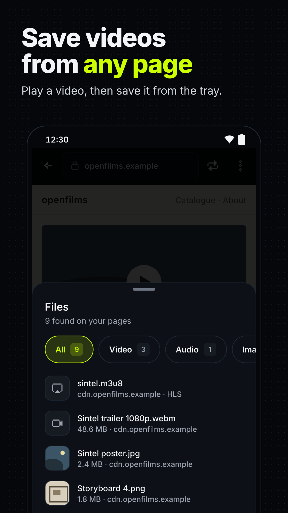
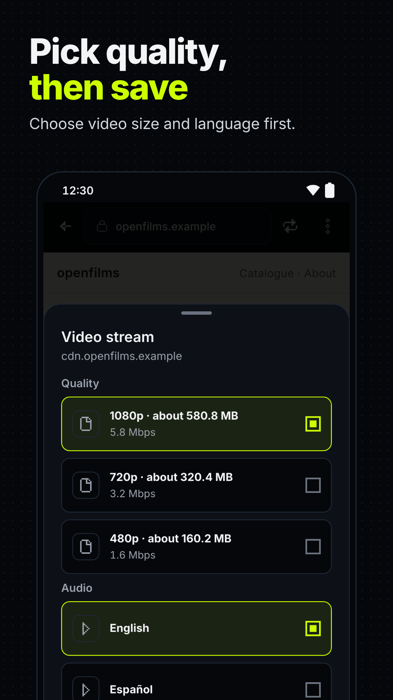
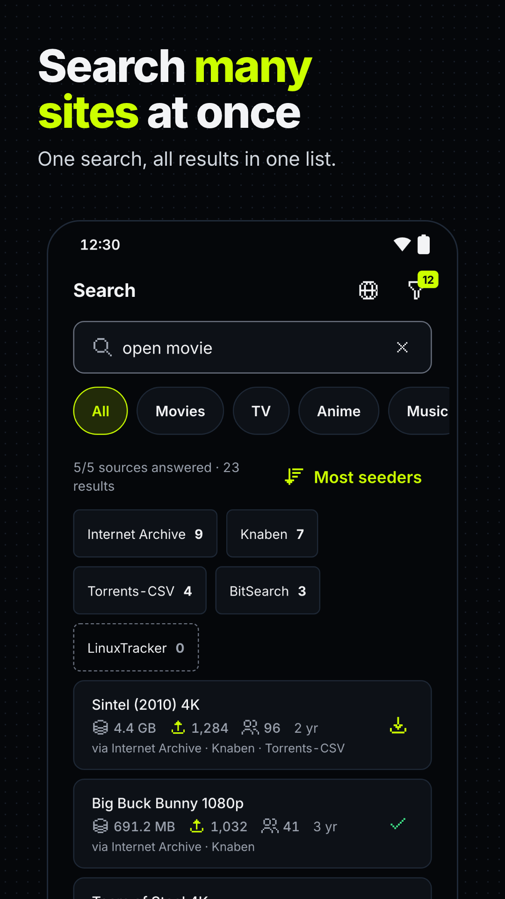
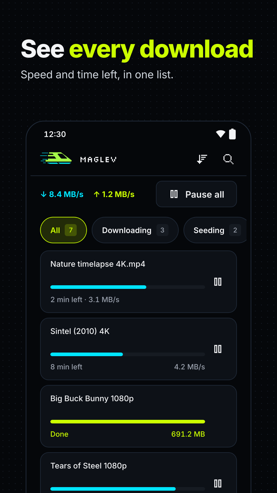
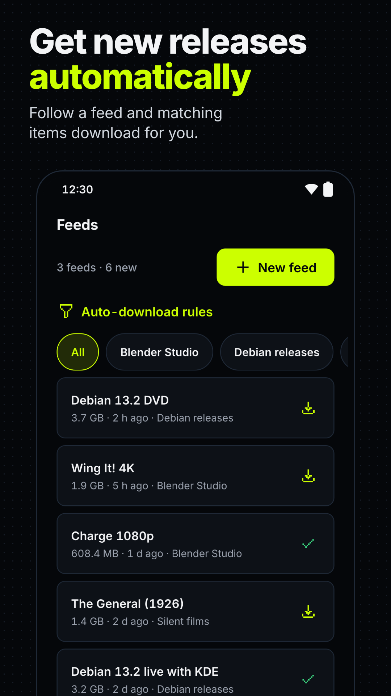
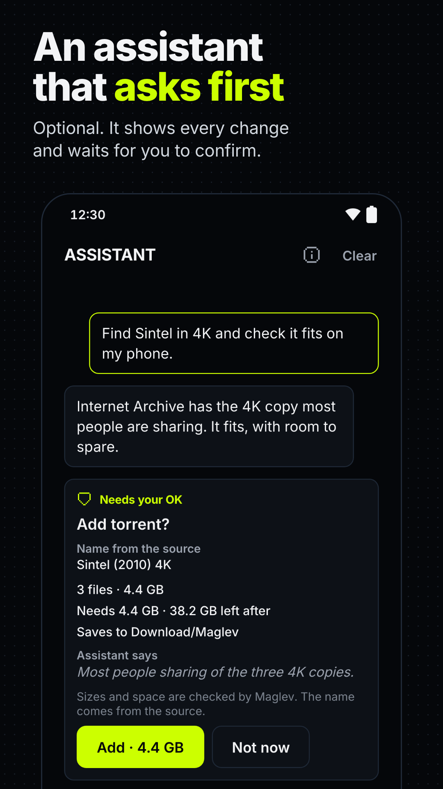

<p align="center">
  
</p>

<p align="center">
  <a href="https://github.com/Kaos599/Maglev/actions/workflows/ci.yml"></a>
  <a href="https://github.com/Kaos599/Maglev/releases"></a>
  
  
  
</p>

<p align="center">
  Maglev downloads anything on Android: torrents, ordinary links, and the videos and files on a web page.<br>
  One small, fast app with a pixel-art look, a real Rust engine, and no ads.
</p>

<p align="center">
  <a href="https://github.com/Kaos599/Maglev/releases/latest"><b>Download Maglev</b></a>
  &nbsp;·&nbsp;
  <a href="https://apps.obtainium.imranr.dev/redirect?r=obtainium://add/https://github.com/Kaos599/Maglev">Get updates with Obtainium</a>
  &nbsp;·&nbsp;
  <a href="#features">Features</a>
  &nbsp;·&nbsp;
  <a href="#whats-next">What's next</a>
</p>

<p align="center">
  
  
  
</p>
<p align="center">
  
  
  
</p>

---

## Features

### Torrents, done properly
- The engine is [librqbit](https://github.com/ikatson/rqbit), written in Rust, with DHT, trackers, local peer discovery and web seeds, so archive.org-style torrents download from their mirrors too.
- Open magnet links and `.torrent` files from your browser, a chat app, the clipboard or a share.
- See every file before you start, pick the ones you want and mark one to download first. Maglev tells you how much space will be left before you tap Start.
- A queue decides how many run at once, and seeding stops at the ratio or time you set. Edit trackers, copy the magnet link or save the `.torrent` file.
- Downloads keep going with the screen off. If Android closes the app, Maglev comes back and carries on. On Android 16 and later, progress shows as a live chip in the status bar.

### Any link, with pause and resume
- Paste or share any web link and Maglev downloads the file, with pause, resume and retry that survive a restart.
- Expired links ask for a fresh one and continue where they stopped. Files that need a sign-in work while the app is open, and Maglev never saves your passwords or cookies to disk.
- Links that point at devices on your own network are stopped unless you allow them.

### A browser without ads that saves what you watch
- Open any page inside Maglev. Ads and trackers are blocked before they load, using a built-in list of over 42,000 ad and tracker domains. The list refreshes itself once a day, and so do any lists you add in Settings.
- Play a video and Maglev lists it. The page's files show up in a tray you can filter by Video, Audio, Image, Document and Other. Tap one to download it with the page's cookies, so files that need the site's session still work.
- Streaming videos (HLS and DASH) are saved as one file: pick the quality and audio language and Maglev joins the pieces, including HLS streams with standard AES-128 encryption.
- A history of the pages you open, with search, suggestions as you type and clearing by time. It can clear itself when you close Maglev, and it never leaves your phone.
- Tabs, with a tab list and a long-press menu on links and images: open in a new or background tab, copy, share or download. Find in page and text size are in ⋮.
- Pop-ups and redirects you didn't tap for wait until you choose Open, Block or Always allow on this site. Bad certificates and requests for your camera, microphone or location are refused. App installers come with a warning.
- Maglev never gets around DRM. Netflix-style protected video, live streams and players that hide their video in the page (YouTube-style) can't be saved, and Maglev says so.

### Search across 40+ sources
- One search box asks public sources such as Knaben, Torrents-CSV, Internet Archive, Nyaa, YTS, EZTV and 1337x at the same time, and merges results that point to the same torrent.
- Results from sources known for fake uploads carry a warning.
- Source addresses and the default trackers come from a signed list that refreshes once a day, so a source that moves keeps working without an app update.
- Filter by category, sort by seeders, size or date, and choose which sources answer each category. Add your own Jackett or Prowlarr indexer.
- A source behind a Cloudflare check opens it once in Maglev so you can pass it yourself.

### Feeds that download new episodes
- Follow a show from Search, or add any RSS feed, and Maglev adds new episodes that match your rules.

### An assistant that asks first (optional)
- Ask in plain words: "find the latest season of this show in 1080p", "why is this stuck?", "what's eating my storage?".
- It searches, compares results, checks size and free space, and explains problems. It always shows what it wants to add or change and waits for you to tap Confirm.
- It runs on your own [OpenRouter](https://openrouter.ai) key, kept in the phone's secure storage, and works with free models. Turn it off and the tab disappears.

### You stay in control
- Wi-Fi only, VPN required, pause on low battery, and download only while charging.
- Speed limits for everything or per download, a schedule for when downloads run or slow down, and Pause all, Resume all and Shut down from the notification.
- A Quick Settings tile, an alert when a download finishes, and Open, Share or Open folder right from the finished item.
- Files land in `Download/Maglev`, where any file manager finds them, or in any folder you choose. Move a torrent's files mid-download, and stream video before it finishes.
- Updates from inside the app: a daily check, downloads on Wi-Fi, and an install you confirm (or let run on its own). F-Droid, Obtainium and store installs keep their own updates.
- OLED, Dim and Light themes with four accent colours, in a retro pixel-art style that stays easy to read.

## Install

Download an APK from [Releases](https://github.com/Kaos599/Maglev/releases/latest), or add Maglev to [Obtainium](https://github.com/ImranR98/Obtainium) so new versions install as they come out:

<a href="https://apps.obtainium.imranr.dev/redirect?r=obtainium://add/https://github.com/Kaos599/Maglev"></a>

| File | Choose it if |
|---|---|
| `Maglev-<version>-arm64-v8a.apk` | your phone is from the last six years. Most people want this one. |
| `Maglev-<version>-armeabi-v7a.apk` | you have an older 32-bit phone. |
| `Maglev-<version>-x86_64.apk` | you use an emulator or a Chromebook. |
| `Maglev-<version>-universal.apk` | you aren't sure. It runs on every device. |

## What's next

- **Browser basics (0.24).** Bookmarks and a new-tab page, file upload on web forms, sign-in prompts for routers and NAS pages, site dialogs (confirm and alert), and HTTPS first for typed addresses.
- Search inside the browser's found files, and keeping a page's file list after you leave it.
- Choosing which ad-block lists to combine, and per-site rules beyond "allow ads here".
- A Google Play build.

## Contributing

<details>
<summary>Build from source and run the tests</summary>

### Build from source

You need Node 22, the Android SDK and a device or emulator. CI compiles the Rust engine (`libmaglev_core.so`) on every push, so there's no Rust toolchain to install.

```bash
git clone https://github.com/Kaos599/Maglev.git && cd Maglev
npm install --legacy-peer-deps
npx expo run:android
```

Debug builds use a mock engine until the native library is present. For the real engine, download the `jniLibs-<abi>` artifact from a CI run and unpack it into `modules/maglev-engine/android/src/main/jniLibs/`. Maglev ships its own native module, so it runs as a development build (`expo run:android`) rather than in Expo Go.

### Tests

```bash
npm test                 # ABI-split plugin + contract suite
npm run test:contracts   # contract suite on its own
npm run test:search      # search providers against offline fixtures
node scripts/test-plugins.js
```

CI also runs the Rust unit tests and checks every engine build for librqbit symbols and 16 KB page alignment.

Icons are [Pixelarticons](https://github.com/halfmage/pixelarticons) by Gerrit Halfmann (MIT).

The browser's built-in block list comes from the [StevenBlack/hosts](https://github.com/StevenBlack/hosts) base list (MIT), 42,042 domains, built 2026-11-12. Rebuild it with `node scripts/build-blocklist.js`.

</details>

## Legal

Maglev doesn't host or index any content. Search sends your query to public indexes run by third parties, and the browser talks only to the sites you open and the block-list addresses in Settings. The assistant sends your messages to OpenRouter only when you use it. What you download, and following the law where you live, is up to you.

## License

Maglev is free software under the [GNU General Public License v3.0](LICENSE). You can use, study, change and share it. If you distribute a changed version, its source must stay available under the same licence.

It includes a modified copy of [librqbit](https://github.com/ikatson/rqbit) by Igor Katson, under the [Apache License 2.0](native/maglev-core/vendor/librqbit/LICENSE). The changes are listed in [`MAGLEV_PATCH.md`](native/maglev-core/vendor/librqbit/MAGLEV_PATCH.md).
