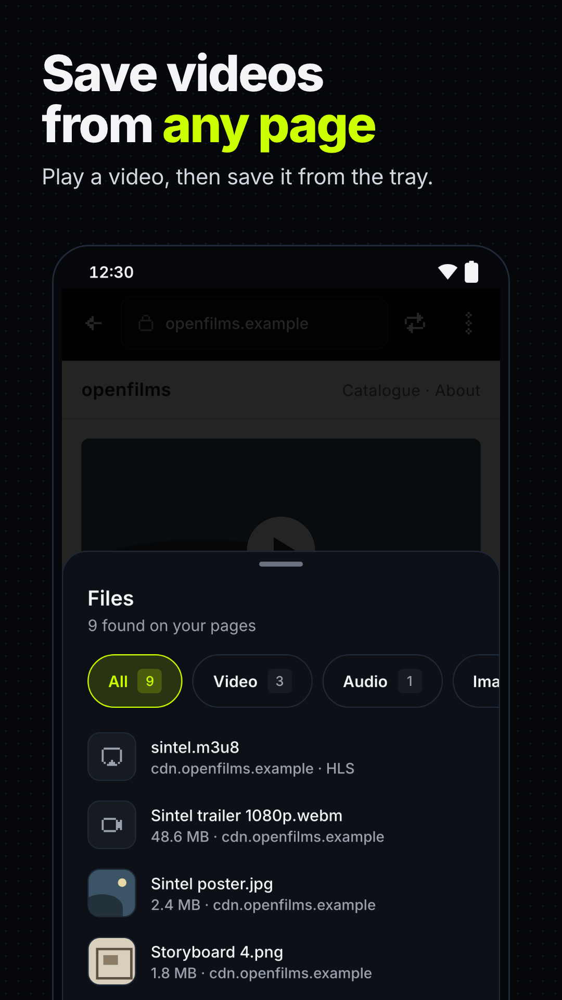
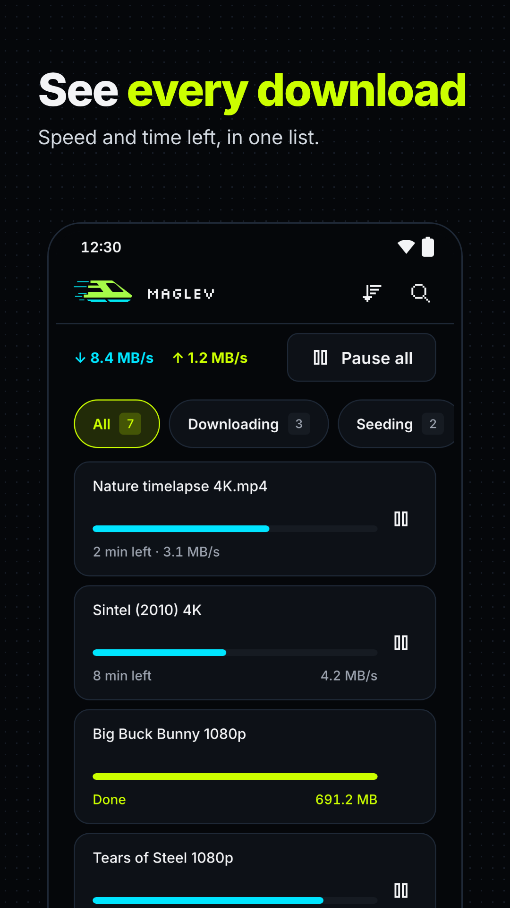
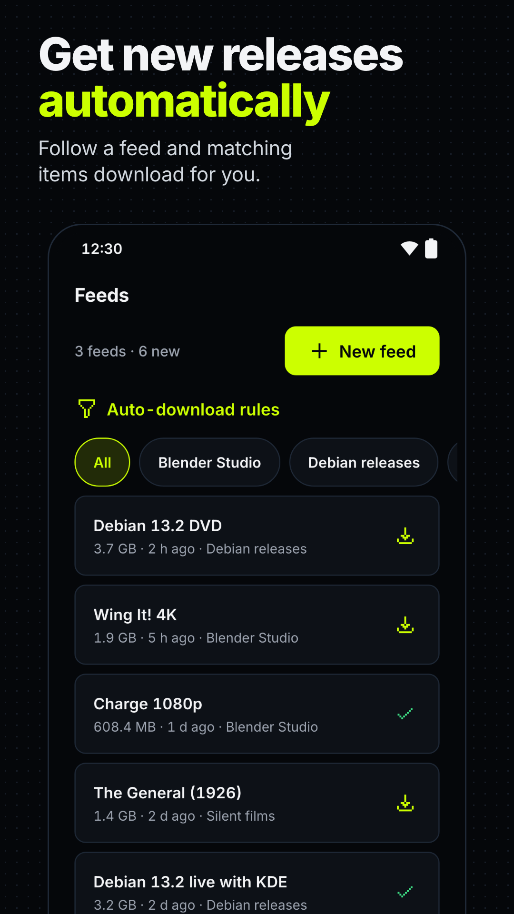

<p align="center">
  
</p>

<p align="center">
  <a href="https://github.com/Kaos599/Maglev/actions/workflows/ci.yml"></a>
  <a href="https://github.com/Kaos599/Maglev/releases"></a>
  
  
  
</p>

## Table of contents

- [Intro](#intro)
- [Screenshots](#screenshots)
- [Download](#download)
  - [Check the APK is genuine](#check-the-apk-is-genuine)
- [Coming from another app?](#coming-from-another-app)
- [Features](#features)
- [What's next](#whats-next)
- [Building from source](#building-from-source)
- [Contributing](#contributing)
- [Disclaimer](#disclaimer)
- [License](#license)

## Intro

Maglev is a free, open-source Android app that downloads torrents, ordinary links, and the videos and files on a web page, in one place. It replaces a torrent client, a download manager and a video saver with one small app that has no ads, no tracking and no account. It runs on Android 7 and later.

## Screenshots

<p align="center">
  
  
  
</p>
<p align="center">
  
  
  
</p>

## Download

> [!NOTE]
> Maglev needs Android 7.0 or later. It isn't on Google Play yet, so you install it from GitHub, or with Obtainium to get updates automatically.

[](https://github.com/Kaos599/Maglev/releases/latest)
[](https://apps.obtainium.imranr.dev/redirect?r=obtainium://add/https://github.com/Kaos599/Maglev)

Each release has four APKs. Pick the one for your phone:

| File | Choose it if |
|---|---|
| `Maglev-<version>-arm64-v8a.apk` | your phone is from the last six years. Most people want this one. |
| `Maglev-<version>-armeabi-v7a.apk` | you have an older 32-bit phone. |
| `Maglev-<version>-x86_64.apk` | you use an emulator or a Chromebook. |
| `Maglev-<version>-universal.apk` | you aren't sure. It runs on every device. |

### Check the APK is genuine

Release APKs are built by GitHub Actions from this repository, and every one is signed with the same key. Its SHA-256 certificate fingerprint is:

```
c8e15bd47fb39fb2248d8b501a677e61be564d52ba535e31a1608564e35df3c4
```

To check a file before you install it, run `apksigner verify --print-certs` on it (apksigner comes with the Android SDK build tools) and compare the `SHA-256 digest` line with the fingerprint above.

## Coming from another app?

Side-by-side guides for the apps people most often replace with Maglev, with what is the same, what is different and when the other app is the better pick:

- [Maglev vs 1DM+](https://harshdayal.dev/maglev/1dm-alternative)
- [Maglev vs ADM](https://harshdayal.dev/maglev/adm-alternative)
- [Maglev vs LibreTorrent](https://harshdayal.dev/maglev/libretorrent-alternative)
- [Maglev vs Flud](https://harshdayal.dev/maglev/flud-alternative)

The [full comparison](https://harshdayal.dev/maglev/compare) covers ten Android apps, row by row, with a source for every answer.

## Features

### Torrents
- Open magnet links and `.torrent` files from any app.
- Pick which files to download before you start.
- Keeps going with the screen off, and picks up again if Android closes the app.
- Stop seeding at a ratio or time you choose.

### Any link
- Paste or share a link to download the file.
- Pause, resume and retry, even after a restart.
- An expired link asks for a fresh one and carries on where it stopped.

### A browser that saves videos
- Blocks ads and trackers before they load.
- Play a video and Maglev lists it, along with the page's other files.
- Saves streaming video (HLS and DASH) as one file, at the quality you pick.
- Tabs, history and pop-up blocking.
- Doesn't get around DRM. Netflix-style video, live streams and YouTube-style players can't be saved, and Maglev says so.

### Search
- One search box across 40+ public sources, with duplicate results merged.
- A warning on sources known for fake uploads.
- Add your own Jackett or Prowlarr indexer.

### Feeds
- Follow a show or add any RSS feed, and new episodes download by your rules.

### Assistant (optional)
- Ask in plain words, like "why is this stuck?" or "what's eating my storage?".
- It shows what it wants to do and waits for you to confirm.
- Runs on your own [OpenRouter](https://openrouter.ai) key. Turn it off and the tab disappears.

### You stay in control
- Wi-Fi only, VPN only or charging only, and a pause when the battery runs low.
- Speed limits and a schedule for when downloads run.
- Files go to `Download/Maglev`, or any folder you choose.
- OLED, Dim and Light themes.

Everything else is on the [Maglev website](https://harshdayal.dev/maglev#features).

## What's next

- **Browser basics (0.25).** Bookmarks and a new-tab page, file upload on web forms, sign-in prompts for routers and NAS pages, site dialogs (confirm and alert), and HTTPS first for typed addresses.
- Search inside the browser's found files, and keeping a page's file list after you leave it.
- Choosing which ad-block lists to combine, and per-site rules beyond "allow ads here".
- A Google Play build.

## Building from source

**Requirements:**

- Node 22
- The Android SDK
- A phone or emulator

You don't need Rust. CI compiles the engine (`libmaglev_core.so`) on every push.

```bash
git clone https://github.com/Kaos599/Maglev.git && cd Maglev
npm install --legacy-peer-deps
npx expo run:android
```

Debug builds use a mock engine until the native library is present. For the real engine, download the `jniLibs-<abi>` artifact from a CI run and unpack it into `modules/maglev-engine/android/src/main/jniLibs/`. Maglev ships its own native module, so it runs as a development build (`expo run:android`), not in Expo Go.

**Tests:**

```bash
npm test                 # ABI-split plugin + contract suite
npm run test:contracts   # contract suite on its own
npm run test:search      # search providers against offline fixtures
node scripts/test-plugins.js
```

CI also runs the Rust unit tests and checks every engine build for librqbit symbols and 16 KB page alignment.

Icons are [Pixelarticons](https://github.com/halfmage/pixelarticons) by Gerrit Halfmann (MIT). The browser's built-in block list comes from the [StevenBlack/hosts](https://github.com/StevenBlack/hosts) base list (MIT); rebuild it with `node scripts/build-blocklist.js`.

## Contributing

Bug reports, fixes and ideas are welcome. Read [CONTRIBUTING.md](CONTRIBUTING.md) before you open a pull request. To report a bug, use **About → Report a bug** in the app, or the [bug report form](https://github.com/Kaos599/Maglev/issues/new?template=bug.yml). Security problems go through [private reporting](https://github.com/Kaos599/Maglev/security/advisories/new).

Much of Maglev's code is written by AI agents from my specs. I review every change, and contract tests decide what ships.

## Disclaimer

Maglev **does not host, store or distribute any content**. Search sends your query to public indexes run by third parties, and the browser talks only to the sites you open and the block-list addresses in Settings. The assistant sends your messages to OpenRouter only when you use it.

What you download, and following the law where you live, is up to you.

## License

Maglev is free software under the [GNU General Public License v3.0](LICENSE). You can use, study, change and share it. If you distribute a changed version, its source must stay available under the same licence.

It includes a modified copy of [librqbit](https://github.com/ikatson/rqbit) by Igor Katson, under the [Apache License 2.0](native/maglev-core/vendor/librqbit/LICENSE). The changes are listed in [`MAGLEV_PATCH.md`](native/maglev-core/vendor/librqbit/MAGLEV_PATCH.md).
