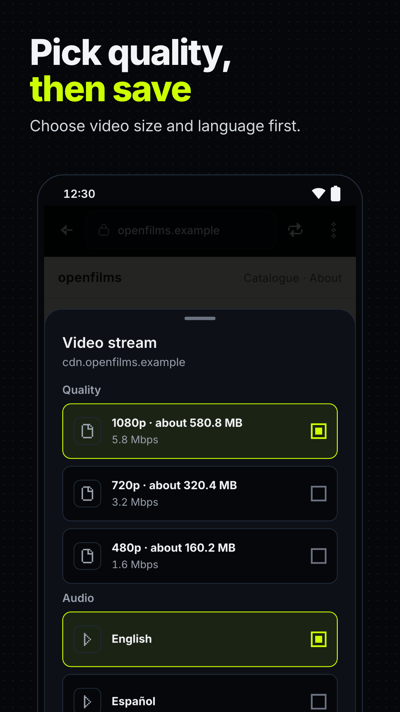
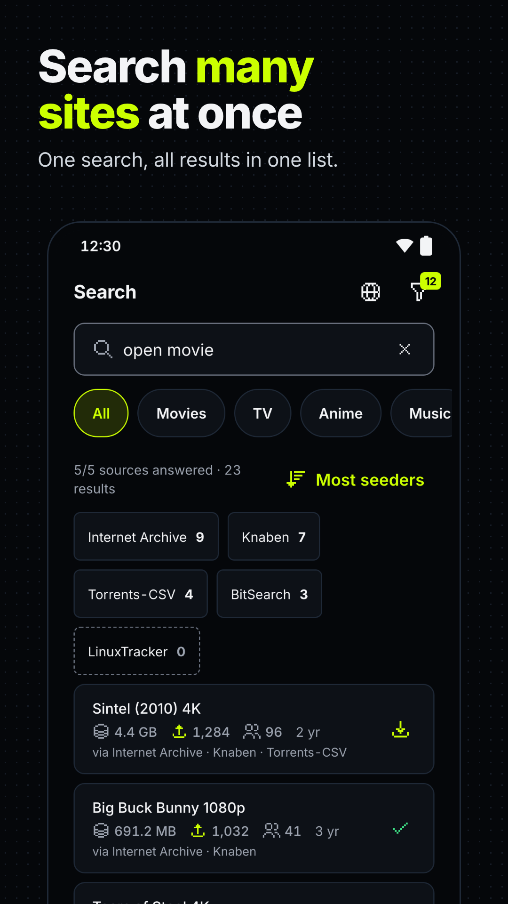
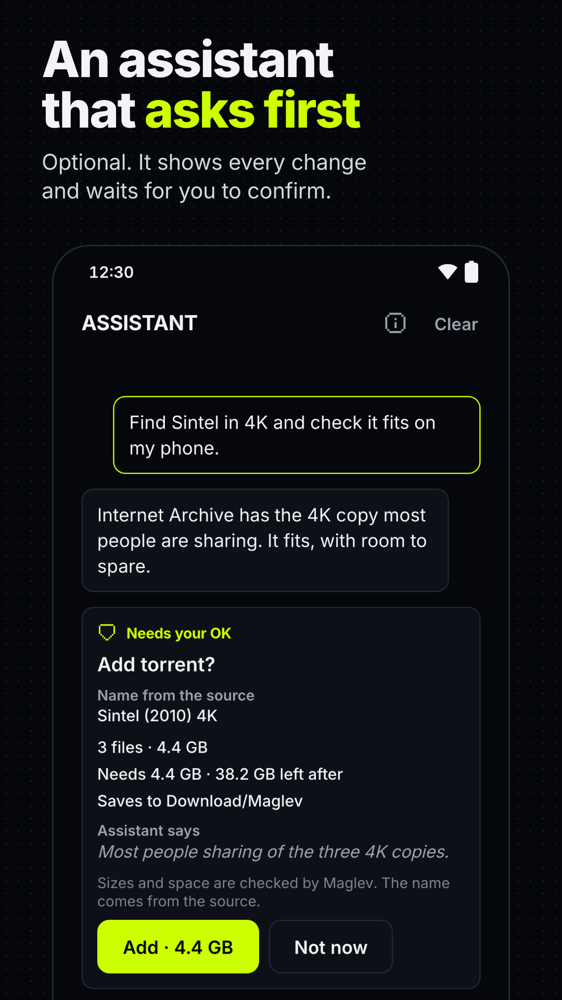

<p align="center">
  
</p>

<p align="center">
  <a href="https://github.com/Kaos599/Maglev/actions/workflows/ci.yml"></a>
  <a href="https://github.com/Kaos599/Maglev/releases"></a>
  <a href="https://github.com/Kaos599/Maglev/releases"></a>
  
  
  
</p>

<p align="center">
  <a href="https://www.saashub.com/maglev-downloader"></a>
  <a href="https://www.opensourcealternatives.to"></a>
</p>

<h3 align="center">Maglev: open-source download manager, video downloader and torrent client for Android</h3>

## Table of contents

- [Intro](#intro)
- [Screenshots](#screenshots)
- [Download](#download)
  - [Check the APK is genuine](#check-the-apk-is-genuine)
- [Features](#features)
- [Comparison with other apps](#comparison-with-other-apps)
  - [A 1DM, ADM and IDM+ alternative](#a-1dm-adm-and-idm-alternative)
  - [A LibreTorrent and Flud alternative](#a-libretorrent-and-flud-alternative)
- [What's next](#whats-next)
- [Building from source](#building-from-source)
- [Contributing](#contributing)
- [Disclaimer](#disclaimer)
- [FAQ](#faq)
- [License](#license)
- [Star History](#star-history)

## Intro

Maglev is a free, open-source download manager for Android. It saves videos from websites (including HLS and m3u8 streams), downloads ordinary links with pause and resume, and works as a torrent client for magnet links and `.torrent` files. It also finds subtitles for the videos you've downloaded.

It replaces a torrent client, a download manager and a video downloader with one small app that has no ads, no tracking and no account. It runs on Android 7 and later, and its source is under the GPL-3.0 licence.

## Screenshots

<p align="center">
  
  
  
</p>
<p align="center">
  
  
  
</p>

## Download

> [!NOTE]
> Maglev needs Android 7.0 or later. It isn't on Google Play yet, so you install it from GitHub, from Orion Store, or with Obtainium to get updates automatically. It isn't on F-Droid yet either.

[](https://github.com/Kaos599/Maglev/releases/latest)
[](https://apps.obtainium.imranr.dev/redirect?r=obtainium://add/https://github.com/Kaos599/Maglev)
[](https://rookieenough.github.io/Orion-Data/redirect.html?id=maglev)

Each release has four APKs. Pick the one for your phone:

| File | Choose it if |
|---|---|
| `Maglev-<version>-arm64-v8a.apk` | your phone is from the last six years. Most people want this one. |
| `Maglev-<version>-armeabi-v7a.apk` | you have an older 32-bit phone. |
| `Maglev-<version>-x86_64.apk` | you use an emulator or a Chromebook. |
| `Maglev-<version>-universal.apk` | you aren't sure. It runs on every device. |

### Check the APK is genuine

Release APKs are built by GitHub Actions from this repository, and every one is signed with the same key. Its SHA-256 certificate fingerprint is:

```
c8e15bd47fb39fb2248d8b501a677e61be564d52ba535e31a1608564e35df3c4
```

To check a file before you install it, run `apksigner verify --print-certs` on it (apksigner comes with the Android SDK build tools) and compare the `SHA-256 digest` line with the fingerprint above.

Each release also has a `SHA256SUMS` file listing the SHA-256 hash of every APK in it. Download it next to the APK and run:

```
sha256sum -c --ignore-missing SHA256SUMS
```

It prints `OK` for each file that matches. On Windows, `Get-FileHash <file> -Algorithm SHA256` gives the same hash to compare by hand. The hashes change with every release; the certificate fingerprint above never does.

## Features

### Torrents and magnet links
- Open magnet links and `.torrent` files from any app.
- Pick which files to download before you start.
- Keeps going with the screen off, and picks up again if Android closes the app.
- Stop seeding at a ratio or time you choose.

### Download manager for any link
- Paste or share a link to download the file.
- Pause, resume and retry, even after a restart.
- Split a file into several parts that download at once (Parts per download), where the server allows it.
- An expired link asks for a fresh one and carries on where it stopped.

### A browser that saves videos (HLS, m3u8 and DASH)
- Blocks ads and trackers before they load.
- Play a video and Maglev lists it, along with the page's other files.
- Saves streaming video (HLS and DASH) as one file, at the quality you pick.
- Tabs (swipe the address bar to switch), history and pop-up blocking.
- Downloads that start without a tap go to the tray, pages can't fill your Back history, known crypto-mining scripts are blocked, and pages open over HTTPS when the site supports it.
- Doesn't get around DRM. Netflix-style video, live streams and YouTube-style players can't be saved, and Maglev says so.

### Subtitles for your videos
- Find subtitles for a video you've downloaded, from 21 free sources, with no account.
- Open a finished link download's menu in Transfers, a torrent's options, or the ⋯ next to a video in its Files tab, then tap **Find subtitles**.
- Results are grouped as "Fits this file", "Probably fits" and "May be out of sync".
- The subtitle is saved next to the video as `<video name>.<lang>.srt` (or `.ass` or `.vtt`), so players pick it up. If one is already there, you choose Replace or Keep both.
- In Settings > Finding things > Subtitle sources you pick and order languages, set a hearing-impaired preference and turn each source on or off. The source list updates itself from Maglev's signed list.
- Two sources match by file fingerprint: Subtis for Spanish and Napisy24 for Polish. The rest match by name.
- Maglev sends the video's name to the sources you turn on, and for those two a fingerprint of the file (its size and a hash of its first and last 64 KB). Nothing else, and nothing until you tap Find subtitles.

### Torrent search
- One search box across 40+ public sources, with duplicate results merged.
- A warning on sources known for fake uploads.
- A size range slider hides results that are too small or too big.
- Add your own Jackett or Prowlarr indexer.

### RSS feeds with auto-download
- Follow a show or add any RSS feed, and new episodes download by your rules.

### Assistant (optional)
- Ask in plain words, like "why is this stuck?" or "what's eating my storage?".
- It shows what it wants to do and waits for you to confirm.
- Runs on your own [OpenRouter](https://openrouter.ai) key. Turn it off and the tab disappears.

### You stay in control
- Wi-Fi only, VPN only or charging only, and a pause when the battery runs low.
- Transfers says why a download is held, with a button to change that setting.
- Speed limits and a schedule for when downloads run.
- Files go to `Download/Maglev`, or any folder you choose.
- Swipe a row in Transfers to pause, resume or remove it, and see a file type icon on each card (a torrent's comes from its biggest file).
- Backup and restore: your settings, search sources, torrents and downloads in one file, and your stats if you tick Include stats. API keys are never included.
- Search your settings from the top of Settings. After an update, a short sheet shows the main new feature.
- OLED, Dim and Light themes.

Everything else is on the [Maglev website](https://harshdayal.dev/maglev#features).

## Comparison with other apps

The [full comparison](https://harshdayal.dev/maglev/compare) covers ten Android apps, row by row, with a source for every answer.

### A 1DM, ADM and IDM+ alternative

Looking for a 1DM alternative, an IDM-style download manager for Android, or an ADM (Advanced Download Manager) alternative? Maglev covers the same everyday jobs, and its code is open.

What carries over:

- Download ordinary links in several parts at once, with pause, resume and retry, even after a restart.
- A built-in browser that finds the videos and files on a page.
- Torrents and magnet links in the same app.
- Wi-Fi only, speed limits, a schedule and a pause on low battery.

What differs:

- Maglev is open source (GPL-3.0). Its browser blocks ads and trackers, and the app has no ads and no analytics.
- It saves streaming video (HLS and DASH) as one file at the quality you pick.
- It searches torrent sites from one box.
- It finds subtitles for videos you've downloaded, from 21 free sources.

Side-by-side guides, with what is the same, what is different and when the other app is the better pick:

- [Maglev vs 1DM+](https://harshdayal.dev/maglev/1dm-alternative)
- [Maglev vs ADM](https://harshdayal.dev/maglev/adm-alternative)

### A LibreTorrent and Flud alternative

Looking for an open-source torrent client for Android? Maglev opens magnet links and `.torrent` files, lets you pick files, follows RSS feeds and runs in the background, like LibreTorrent and Flud.

What carries over:

- Magnet links, `.torrent` files and file selection.
- RSS feeds with download rules.
- A Wi-Fi only option.

What differs:

- Maglev also downloads ordinary links and saves videos from web pages, so you don't need a second app.
- Search runs across 40+ public sources with duplicates merged. You can add your own Jackett or Prowlarr indexer.
- It finds subtitles for the videos you download, from 21 free sources.
- It has no ads and no tracking. Maglev is open source, as LibreTorrent is. Flud's source isn't published.

Side-by-side guides:

- [Maglev vs LibreTorrent](https://harshdayal.dev/maglev/libretorrent-alternative)
- [Maglev vs Flud](https://harshdayal.dev/maglev/flud-alternative)

## What's next

- Bookmarks, and sign-in prompts for routers and NAS pages. (The rest of Browser basics, from 0.25, has shipped: a new-tab page, file upload on web forms, and site dialogs.)
- Search inside the browser's found files, and keeping a page's file list after you leave it.
- Choosing which ad-block lists to combine, and per-site rules beyond "allow ads here".
- A Google Play build.

## Building from source

**Requirements:**

- Node 22
- The Android SDK
- A phone or emulator

You don't need Rust. CI compiles the engine (`libmaglev_core.so`) on every push.

```bash
git clone https://github.com/Kaos599/Maglev.git && cd Maglev
npm install --legacy-peer-deps
npx expo run:android
```

Debug builds use a mock engine until the native library is present. For the real engine, download the `jniLibs-<abi>` artifact from a CI run and unpack it into `modules/maglev-engine/android/src/main/jniLibs/`. Maglev ships its own native module, so it runs as a development build (`expo run:android`), not in Expo Go.

**Tests:**

```bash
npm test                 # ABI-split plugin + contract suite
npm run test:contracts   # contract suite on its own
npm run test:search      # search providers against offline fixtures
node scripts/test-plugins.js
```

CI also runs the Rust unit tests and checks every engine build for librqbit symbols and 16 KB page alignment.

Subtitle sources are ported from the [Bazarr+](https://github.com/LavX/bazarr-provider-catalog) provider catalog (MIT). Icons are [Pixelarticons](https://github.com/halfmage/pixelarticons) by Gerrit Halfmann (MIT). The browser's built-in block list comes from the [StevenBlack/hosts](https://github.com/StevenBlack/hosts) base list (MIT); rebuild it with `node scripts/build-blocklist.js`.

## Contributing

Bug reports, fixes and ideas are welcome. Read [CONTRIBUTING.md](CONTRIBUTING.md) before you open a pull request. For a new screen, follow [DESIGN.md](DESIGN.md). To report a bug, use **About → Report a bug** in the app, or the [bug report form](https://github.com/Kaos599/Maglev/issues/new?template=bug.yml). Security problems go through [private reporting](https://github.com/Kaos599/Maglev/security/advisories/new) (see [SECURITY.md](SECURITY.md)). Everyone taking part follows the [code of conduct](CODE_OF_CONDUCT.md).

Much of Maglev's code is written by AI agents from my specs. I review every change, and contract tests decide what ships.

## Disclaimer

Maglev **does not host, store or distribute any content**. Search sends your query to public indexes run by third parties, and the browser talks only to the sites you open and the block-list addresses in Settings. The assistant sends your messages to OpenRouter only when you use it.

What you download, and following the law where you live, is up to you.

## FAQ

### Is Maglev a 1DM alternative?

Yes. Like 1DM+, Maglev downloads web links and torrents and has a browser that finds videos on a page. Maglev is open source and has no ads. See [Maglev vs 1DM+](https://harshdayal.dev/maglev/1dm-alternative).

### Is there an open-source download manager for Android?

Maglev is one. It is free software under the GPL-3.0, and the code is in this repository.

### Can Maglev download m3u8 or HLS videos?

Yes, on-demand HLS (`.m3u8`) and DASH streams, including HLS with standard AES-128 encryption. Maglev lists the pieces, lets you pick quality and audio, and joins them into one video file. It refuses DRM-protected video and live streams, and says why.

### Can Maglev download subtitles?

Yes, for videos you have already downloaded. Tap **Find subtitles** on a finished download, or on a video in a torrent's Files tab. Maglev searches 21 free sources, with no account, and groups the results by how well they fit the file. The subtitle is saved next to the video, so players pick it up. Two sources match by file fingerprint (Subtis for Spanish, Napisy24 for Polish). The rest match by name, so check the fit. It doesn't fetch subtitles by itself when a download finishes.

### Can Maglev download torrents and magnet links?

Yes. Open a magnet link or `.torrent` file from any app, pick the files you want, and Maglev downloads them in the background. It can also search public torrent sources and follow RSS feeds.

### Does Maglev have ads or tracking?

No. The app has no ads, no analytics SDKs and no account. The built-in browser blocks ads and trackers on the pages you open.

### Can I back up Maglev and restore it on a new phone?

Yes. In Settings > Backup, export one file with your settings, search sources, torrents and downloads, and your stats if you tick Include stats. API keys are never included. On the new phone, open the file in Settings > Backup and choose what to restore.

### Which Android versions does Maglev support?

Android 7.0 and later.

## License

Maglev is free software under the [GNU General Public License v3.0](LICENSE). You can use, study, change and share it. If you distribute a changed version, its source must stay available under the same licence.

It includes a modified copy of [librqbit](https://github.com/ikatson/rqbit) by Igor Katson, under the [Apache License 2.0](native/maglev-core/vendor/librqbit/LICENSE). The changes are listed in [`MAGLEV_PATCH.md`](native/maglev-core/vendor/librqbit/MAGLEV_PATCH.md).

## Star History

<a href="https://www.star-history.com/?repos=kaos599%2Fmaglev&type=date&legend=bottom-right">
 <picture>
   <source media="(prefers-color-scheme: dark)" srcset="https://api.star-history.com/chart?repos=kaos599/maglev&type=date&theme=dark&legend=bottom-right" />
   <source media="(prefers-color-scheme: light)" srcset="https://api.star-history.com/chart?repos=kaos599/maglev&type=date&legend=bottom-right" />
   
 </picture>
</a>
