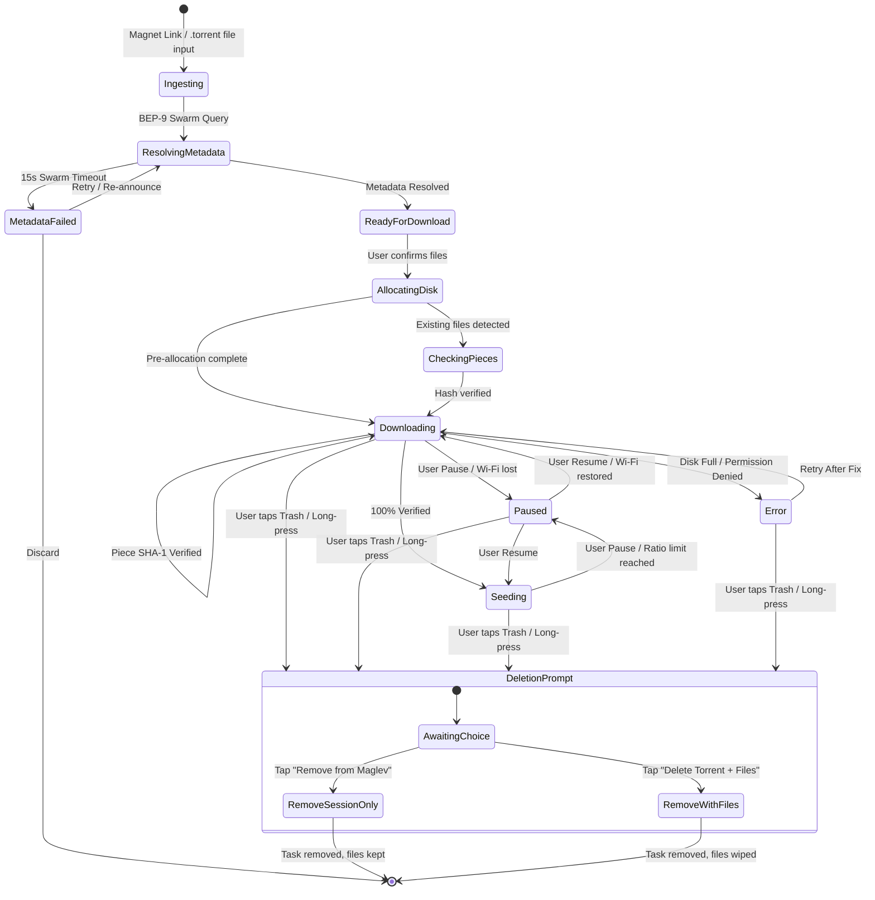
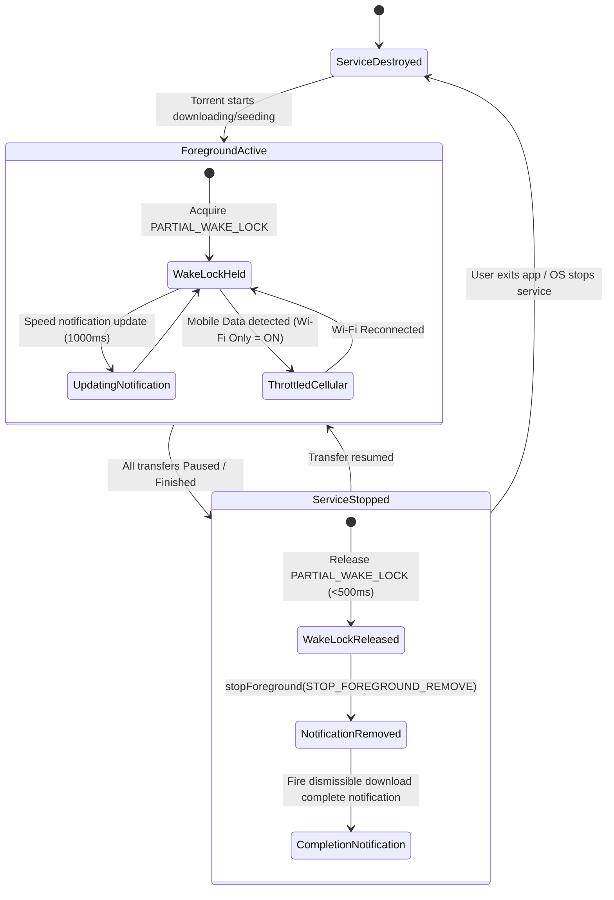

# MAGLEV — Screen Catalog & Comprehensive State Machines (Audited & Locked)

---

## 1. Master Screen Catalog

| Screen ID | Screen Name | Route / Modal | Key Responsibilities |
|---|---|---|---|
| **SCR-01** | **Active Transfers (Main Screen)** | `/transfers` | Aggregate speed header (`[Pause All]` / `[Resume All]`), filter pills (All, Down, Up, Paused), modular transfer cards, floating `[+]` FAB. |
| **SCR-02** | **Transfers Empty State** | `/transfers/empty` | Minimal 8-bit download tray icon, "No active transfers" header, direct `[+ Add Torrent]` and `[Search Torrents]` buttons. |
| **SCR-03** | **Add Torrent Sheet** | Modal `/add-torrent` | BEP-9 metadata preview, default storage path with `[Change]` override, file checklist with batch `[Select All]` and `.ext` chips, sequential stream toggle, Start action. |
| **SCR-04** | **Torrent Detail Screen** | `/torrent/:id` | Header metadata pill, live speed chart, and 4 tab views: `[FILES]`, `[PIECES]`, `[PEERS]`, and `[TRACKERS]`. Dual-action trash button. |
| **SCR-05** | **Search & Browse Screen** | `/search` | Search box with clear action, horizontal category pills (9 categories), recent searches chips, bookmark icon, search result cards with instant `+ Add` trigger. |
| **SCR-06** | **Automated Feeds Screen** | `/feeds` | Feed channel pills (`All Feeds`, `Linux Distros`, `EZTV`, etc.), `+ Add Feed` button, feed release items with 1-touch download and auto-download badges. |
| **SCR-07** | **System Settings** | `/settings` | 5 grouped sections: Transfers & Network, General Theming (Pure Black/Dark/Light), Content & Privacy (NSFW toggle/blur), Search & Feeds, About. |

---

## 2. Macro State Machines

### 2.1 Torrent Lifecycle State Machine
Governs the core download, verification, and seeding pipeline.

### 2.2 Android Background Power & Service State Machine
Controls Foreground Service, notification lifecycle, and `PARTIAL_WAKE_LOCK`.

---

## 3. Micro Component-Level State Machines

### 3.1 Torrent Card Action Button (`PLAY` / `PAUSE` / `STOP`)
* **Purpose:** One-tap state changer on the right of each transfer card.
* **Touch Target:** Minimum 44×44px hit bounds (`min-w-[44px] min-h-[44px]`).
* **States:**
  * `STATE_DOWNLOADING`: Displays Pause icon `||` in dark square container. Tapping dispatches `engine.pauseTorrent(hash)` and transitions to `STATE_PAUSED`.
  * `STATE_SEEDING`: Displays Stop square icon `■` with micro-label `STOP`. Tapping halts seeding and transitions to `STATE_PAUSED`.
  * `STATE_PAUSED`: Displays Resume arrow icon `▶` with micro-label `RESUME` in lime outline. Tapping dispatches `engine.resumeTorrent(hash)` and transitions to `STATE_DOWNLOADING`.
  * `STATE_ERROR`: Displays Retry icon `↻` with high-contrast plain-language error label (e.g. `Storage Full` or `Permission Denied`).
  * `STATE_BUSY`: Displays a subtle 1-tick spinner when state transition is in flight across the JSI bridge. Button is disabled to prevent rapid multi-clicks.

### 3.2 Floating Action Button (FAB) `[+]`
* **Purpose:** Quick addition trigger on the main transfer screen.
* **States:**
  * `DEFAULT`: Docked bottom-right (`bottom: 80px`, `right: 16px`), neon lime background (`#CCFF00`), black bold 8-bit `+` icon, 48×48px.
  * `PRESSED`: Scale `0.95`, background `#D4FF00`.
  * `OPENED`: Add Torrent Sheet `/add-torrent` opens; FAB gracefully transforms into close trigger.

### 3.3 Category Filter Pills (Horizontal Bar)
* **States per Pill:**
  * `ACTIVE`: Acid Lime background (`#CCFF00`), black bold typography (`10px`), min-height 44px. Tapping active pill keeps it active.
  * `INACTIVE`: Dark card background (`#0D1117`), border `1px solid #1F2937`, white/gray text. Tapping transitions this pill to `ACTIVE` and deactivates prior pill.
  * `SWIPE_GESTURE`: Horizontal swipe across the viewport cycles between filter pills one-handed.

### 3.4 Pieces 16×16 Block Matrix (256 Blocks)
* **Block State Rules:**
  * `BLOCK_UNAVAILABLE` (`#161D26`): Swarm has not completed verification of these blocks.
  * `BLOCK_IN_FLIGHT` (`#CCFF00` solid lime): Actively being downloaded from peers across open TCP/UDP streams (steady, no pulse).
  * `BLOCK_VERIFIED` (`#00E5FF` steady cyan): Downloaded, hashed with SHA-1, verified match with metadata bitfield.
  * `BLOCK_CORRUPT` (`#FF3366` flash): SHA-1 hash mismatch; automatically discarded and re-queued.

### 3.5 File Multi-Select Checkboxes in Add Torrent Sheet
* **Batch Controls:** Top sticky header provides `[Select All]`, `[Deselect All]`, and extension-filter chips (e.g. `[.mkv only]`).
* **States per File:**
  * `CHECKED`: Acid Lime border & fill with black pixel cross `[X]`. File will be allocated and downloaded.
  * `UNCHECKED`: Dark charcoal box `[ ]`. File will be set to download priority `0` (skipped).
  * `DOWNLOAD_PRIORITY`: Long-press opens priority popup: `High`, `Normal`, `Low`.
