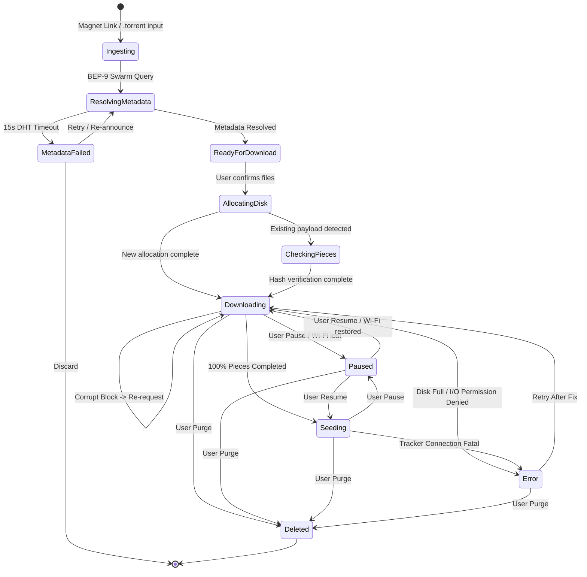
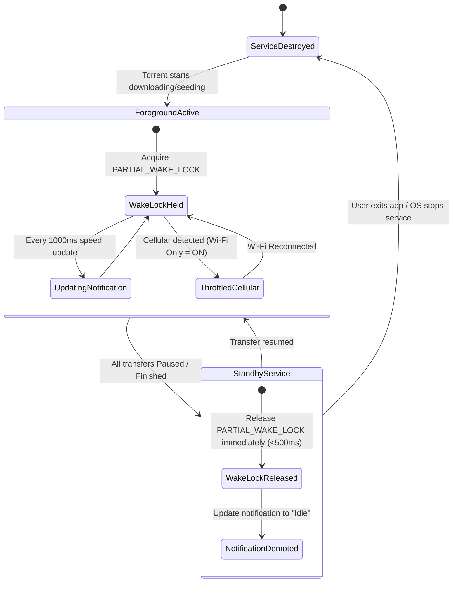
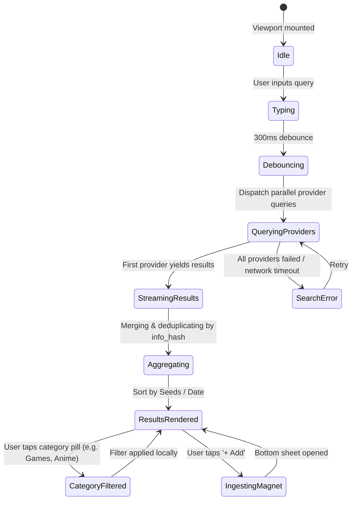

# MAGLEV — Screen Catalog & Comprehensive State Machines

---

## 1. Master Screen Catalog

| Screen ID | Screen Name | Route / Modal | Key Responsibilities |
|---|---|---|---|
| **SCR-01** | **Active Transfers (Main Screen)** | `/transfers` | Aggregate speed header, filter pills (All, Down, Up, Paused), modular torrent cards, floating `[+]` FAB. |
| **SCR-02** | **Transfers Empty State** | `/transfers/empty` | Minimal 8-bit download tray icon, "No active transfers" header, direct `[+ Add Torrent]` and `[Search Torrents]` buttons. |
| **SCR-03** | **Magnet Ingestion Sheet** | Modal `/ingest` | BEP-9 metadata preview, info-hash readout, SAF destination folder selector, file checklist with priorities, sequential stream toggle, Start action. |
| **SCR-04** | **Torrent Detail Screen** | `/torrent/:id` | Header metadata pill, live speed chart, and 3 tab views: `[FILES]`, `[PIECE MAP]`, and `[PEERS]`. |
| **SCR-05** | **Search & Browse Screen** | `/search` | Search box with clear action, horizontal category pills (9 categories), recent searches chips, bookmark icon, search result cards with instant `+ Add` trigger. |
| **SCR-06** | **Automated Feeds Screen** | `/feeds` | Feed channel pills (`All Feeds`, `Linux Distros`, `EZTV`, etc.), `+ Add Feed` button, feed release items with 1-touch download and auto-download badges. |
| **SCR-07** | **System Configuration** | `/config` | 5 grouped sections: Torrent Engine, General Theming (Pure Black/Dark/Light), Content & Privacy (NSFW toggle/blur), Search & Feeds, About. |

---

## 2. Macro State Machines

### 2.1 Torrent Lifecycle State Machine
Governs the core download, verification, and seeding pipeline.

### 2.2 Android Background Service & Power State Machine
Controls Foreground Service, notification lifecycle, and `PARTIAL_WAKE_LOCK`.

### 2.3 Search & Discovery Pipeline State Machine
Governs multi-provider search requests, category filtering, and instant queueing.

---

## 3. Micro Component-Level State Machines

### 3.1 Torrent Card Action Button (`PLAY` / `PAUSE` / `STOP`)
* **Purpose:** One-tap state changer on the right of each transfer card.
* **States:**
  * `STATE_DOWNLOADING`: Displays Pause icon `||` in dark square container. Tapping dispatches `engine.pauseTorrent(hash)` and transitions to `STATE_PAUSED`.
  * `STATE_SEEDING`: Displays Stop square icon `■` with micro-label `STOP`. Tapping halts seeding and transitions to `STATE_PAUSED`.
  * `STATE_PAUSED`: Displays Play arrow icon `▶` with micro-label `START` in lime outline. Tapping dispatches `engine.resumeTorrent(hash)` and transitions to `STATE_DOWNLOADING`.
  * `STATE_ERROR`: Displays Retry icon `↻` in crimson outline `#FF3366`. Tapping re-checks hash and attempts reconnect.
  * `STATE_BUSY`: Displays a subtle 1-tick spinner when state transition is in flight across the JSI bridge. Button is disabled to prevent rapid multi-clicks.

### 3.2 Floating Action Button (FAB) `[+]`
* **Purpose:** Quick ingestion trigger on the main transfer screen.
* **States:**
  * `DEFAULT`: Docked bottom-right (`bottom: 80px`), neon lime background (`#CCFF00`), black bold 8-bit `+` icon, drop shadow glow.
  * `PRESSED`: Scale `0.95`, background `#D4FF00`.
  * `OPENED`: Bottom sheet `/ingest` opens; FAB gracefully fades out or transforms into close trigger.
  * `SCROLLING`: FAB retains docked position with high z-index, pointer events active.

### 3.3 Category Filter Pills (Horizontal Bar)
* **States per Pill:**
  * `ACTIVE`: Acid Lime background (`#CCFF00`), black bold typography (`label-md`), neon glow. Tapping active pill keeps it active.
  * `INACTIVE`: Dark card background (`#0D1117`), border `1px solid #1F2937`, white/gray text. Tapping transitions this pill to `ACTIVE` and deactivates prior pill.
  * `EMPTY_CATEGORY`: If no torrents match category, displays count badge `[0]`; viewport displays clean empty message.

### 3.4 Piece Map 16×16 Block Matrix (256 Blocks)
* **Block State Rules:**
  * `BLOCK_UNAVAILABLE` (`#161D26`): Swarm has not completed verification of these blocks.
  * `BLOCK_IN_FLIGHT` (`#CCFF00` pulsing): Actively being downloaded from peers across open TCP/UDP streams.
  * `BLOCK_VERIFIED` (`#00E5FF` steady cyan): Downloaded, hashed with SHA-1, verified match with metadata bitfield.
  * `BLOCK_CORRUPT` (`#FF3366` flash): SHA-1 hash mismatch; automatically discarded and re-queued.

### 3.5 File Multi-Select Checkboxes in Magnet Ingestion Sheet
* **States per File:**
  * `CHECKED`: Acid Lime border & fill with black pixel cross `[X]`. File will be allocated and downloaded.
  * `UNCHECKED`: Dark charcoal box `[ ]`. File will be set to download priority `0` (skipped).
  * `DOWNLOAD_PRIORITY`: Long-press opens priority popup: `High`, `Normal`, `Low`.

---

## 4. Edge Cases, Race Conditions & Mitigations

| Failure Mode / Edge Case | Risk | Mitigation Architecture |
|---|---|---|
| **Exhausted DHT Peers (Stalled Magnet)** | User gets stuck on "Resolving metadata" forever. | Hard timeout of 15s; displays graceful fallback: "Swarm metadata slow. Retry announce or paste .torrent file directly." |
| **Out-of-Storage During Pre-allocation** | Crash or corrupted partial writes. | Pre-check available bytes via `StatFs` on target SAF directory *before* writing first block. Reject ingestion if `availableBytes < torrentTotalSize`. |
| **Aggressive OEM Battery Killer** | OS abruptly kills background transfer service. | Register `ForegroundService` with notification priority `HIGH`, sticky restart `START_STICKY`, and graceful crash-recovery state saved in MMKV. |
| **Abrupt Wi-Fi to Mobile Data Switch** | Unwanted cellular data billing. | Kotlin `ConnectivityManager` listener intercepts network change instantaneously (<300ms) and pauses engine sockets before data packets leak over 4G/5G. |
| **Rapid Pause/Resume Spam** | Race conditions in Tokio async runtime. | Mutex debounce lock: reject state changes while previous transition is in-flight. |
