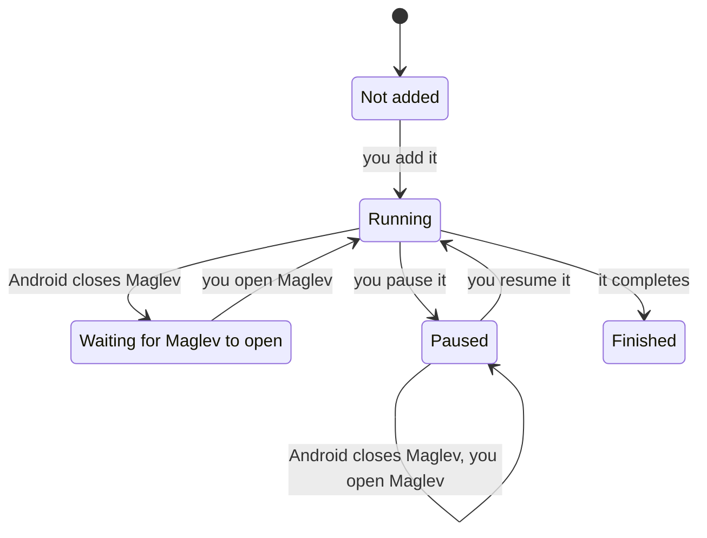

# Pausable downloads

<!-- One or two sentences: what the feature does, in the words someone using the app would use. Then the thing that
     can go wrong, which is the reason the model exists. -->

You can pause a download and resume it later. Android may close Maglev whenever it is in the background, and Maglev restarts the downloads it remembers when you open it again. The model checks that this restart never wakes up a download you paused.

Check it:

```bash
node scripts/check-models.js specs/_template
```

## States

<!-- A Mermaid state chart of the design that passes. Label states with what a person sees, and arrows with what
     they or Android do. About 20 arrows at most; merge states that act the same. -->



## Rules

<!-- One row per invariant in the .tla. The plain-words column is what a reviewer checks the PR against. -->

| Rule | In plain words |
|---|---|
| `PausedStaysPaused` | A download you paused never runs until you resume it. |
| `NothingLost` | When Maglev is on screen, every download you added is running, paused or finished. |
| `TypeOK` | Every variable holds the kind of value its comment promises. |

## Designs tried

<!-- Each design is a .cfg. Keep the rejected ones with "\* expect: fail <Rule> in <N> steps", and say here what broke. -->

| Design | What it did | Result |
|---|---|---|
| `Feature.cfg` | On start, restart every download that is neither paused nor finished. | All rules hold in all 48 reachable states. |
| `ForgetsPaused.cfg` | On start, restart every download that isn't finished, paused or not. | `PausedStaysPaused` breaks in 5 steps: you add a download, pause it, go home, Android closes Maglev, you open Maglev, and it runs again. |

## Actions and the code they stand for

<!-- One row per action in Next. Name the file and the function (the rows below are placeholders). An action Android performs has no code of its
     own: say so, because it is what the code must survive. -->

| Action | Code |
|---|---|
| `YouAdd` | `app/<screen>.tsx` `onStart`: what it calls to add the download |
| `YouPause`, `YouResume` | `<file>` `<function>` |
| `DownloadFinishes` | `<file>` where the engine reports a download complete |
| `YouOpenMaglev` | `<file>` `<function>` that restores saved downloads at start |
| `YouGoHome`, `AndroidKillsMaglev` | Android does these. No Maglev code runs. |

## What the model leaves out

<!-- Anything real that the model does not have, and why leaving it out does not hide the bug you care about. -->

- The background service that keeps downloads running after you leave Maglev. With it, Android closes Maglev less often, but it still can, so the rule must hold without it.
- Progress, speed and errors. They don't change which downloads should run.
