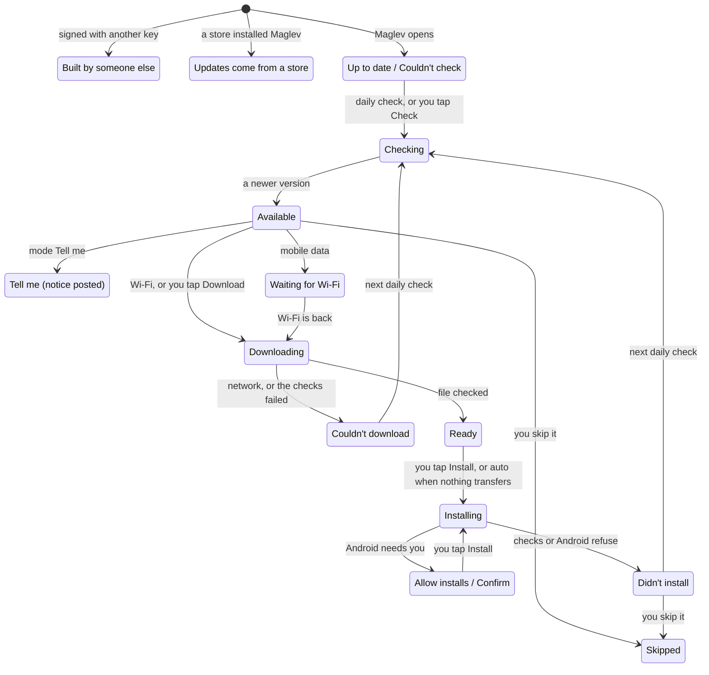

# In-app updates

Maglev checks GitHub for a newer version, downloads the APK, checks it, and hands it to Android to install. Since 1.1.2 a daily background job does the check while Maglev is closed, next to the check the app runs when it opens. The model checks that the two never download at once, that nothing downloads on mobile data without you asking, that a copy signed with someone else's key never downloads at all, and that nothing installs without passing every check, whatever Android closes in between.

Check it:

```bash
node scripts/check-models.js specs/app-updater
```

## Goal

A copy that can't install a release says so before it downloads anything. A release-signed copy finds a new version within a day even if you never open Maglev, and downloads it only on Wi-Fi unless you tap Download.

## States

What the Updates screen shows, in the design that ships (`AppUpdater.cfg`). Android can close Maglev from every state; when it opens again it starts from the top, restoring a file already downloaded as Ready and a version already found as Available.



The background job has no screen. It saves what it found, posts "available" (Tell me) or downloads on an unmetered network and posts "ready" with an Install button, and the app takes that over when it opens.

## Rules

| Rule | In plain words |
|---|---|
| `NeverInstallUnverified` | An install goes ahead only with a file that passes all four checks (SHA-256, package name, a higher versionCode, the installed app's signer) at that moment, on every path: the card, auto install, and the notification's Install button. |
| `ForeignNeverDownloads` | A copy signed with another key never downloads an update, so it never spends 40 to 115 MB on a file Android would refuse. |
| `ManagedNeverDownloads` | A copy installed by a store never downloads an update either. |
| `NoMeteredAutoDownload` | Maglev never starts a download on its own on mobile data or with no network. Only a tap on Download does. |
| `OneDownloadAtATime` | The app and the background job never write the update file at the same time. |
| `RestoreNeverSkipsVerify` | A file left from before Maglev closed is checked again before it is installed. |
| `EveryStateHasAnExit` | Whatever the Updates screen shows, a button, a check or a running download can move it on without restarting Maglev. Only "Built by someone else" and "Updates come from a store" stay. |
| `TypeOK` | Every variable holds the kind of value its comment promises. |

## Designs tried

| Design | What it did | Result |
|---|---|---|
| `AppUpdater.cfg` | Check the installed signer against the release key before anything else, and route the background job's download through the same native call as the app's, which lets one thread write and makes a second caller for the same release join it. | All rules hold in all 9,477 reachable states. |
| `Today.cfg` | Maglev 1.1.1: no signer check before the download, no background job. | `ForeignNeverDownloads` breaks in 4 steps: a release is out, Maglev opens, it checks and finds it, and you tap Download. The checks refuse the file only after the whole download, and the next day's check offers it again. (In "Download on Wi-Fi" mode it starts without the tap.) |
| `NaiveWorker.cfg` | As shipped, but the background job downloads on its own instead of through the app's lock. | `OneDownloadAtATime` breaks in 3 steps: the job starts downloading while Maglev is closed, you open Maglev and it shows the version the job found, and you tap Download: a second download writes the same file. |
| `TrustRestore.cfg` | As shipped, but a file checked before Maglev closed is installed without checking it again. | `RestoreNeverSkipsVerify` breaks in 4 steps: the job downloads the file while Maglev is closed and it passes, you open Maglev and it restores the file as Ready, and you tap Install: it goes to Android without the checks. Had the file changed on disk, or had you installed a newer version by hand in between, nothing would catch it. |

An earlier version of the shipped design also failed `EveryStateHasAnExit`: after the install permission screen had been tried once, and after an install that failed because the file had gone bad, the card's only button did nothing until Maglev restarted. Skip now works from both, Install works from the permission card, and the daily check starts over from a failed install.

## Actions and the code they stand for

| Action | Code |
|---|---|
| `YouOpenMaglev` | `utils/update/index.ts` `startUpdates`: `loadSource` (`getInstallSource`, whose `signer` comes from `ReleaseSigner.check`) dispatches `managed` or `foreign`; then `adoptBackgroundUpdate` (`takeBackgroundUpdate`), the `restore` of `pending`, `cleanupUpdates` and `restoreAvailable`. A foreign copy clears `pending` and `available` and deletes the folder. |
| `YouOrMaglevCheck`, `CheckReturns` | `checkNow` and `onActive` (the 24 h gate, now also from `downloadFailed` and `installFailed`); `runCheck` asks `fetchReleases` (`ReleaseFeed.fetch`: ETag, rate-limit wait) and picks with `pickRelease` in `check.ts`. |
| `AppRoutes` | `routeFound`: `route` with `autoDownloadAllowed` from `rules.ts`. |
| `WifiReturns` | `startWifiWatch` listens to `onNetworkChanged` and calls `pollWifi`; `syncUpdateSchedule` also asks the job for one run on the next unmetered network (`UpdateSchedule.apply`, `UNIQUE_WIFI`). |
| `YouTapDownload` | `downloadNow` (network rules, then `runDownload`). |
| `StartDownload`, `DownloadEnds` | `AppUpdater.download`: refuses `MANAGED` and `FOREIGN_BUILD` first; one `FutureTask` writes, a caller for the same SHA-256 joins it, a caller for another waits. `runDownload` returns a file that already passes at once, and `verify` deletes one that fails. |
| `AppGetsFile` | `runDownload` in `index.ts`: `downloaded` or `downloadFailed` (`UPDATE_INVALID` clears `pending` and `available`). |
| `AppRoutesReady` | `routeReady` with `safeToInstall`. |
| `YouTapInstall`, `PermissionReturned`, `InstallerAnswers` | `installNow`, `onActive`'s `permissionReturned`, the `onUpdateResult` listener; all go through `AppUpdater.install`, which runs `verify` before it opens a session. |
| `YouTapInstallOnNotice` | `UpdateInstallReceiver.startInstall` → `AppUpdater.install`. |
| `YouSkip`, `YouDismissFailure` | `skipThisVersion`, `dismissDownloadFailure`. |
| `JobRuns` | `UpdateCheckWorker` → `UpdateSchedule.runOnce`: stops for a store install, a foreign copy, checking turned off or the network rules; `ReleaseFeed.fetch`, `ReleasePicker.pick` (a copy of `pickRelease`), then a notice, a wait for Wi-Fi, or `AppUpdater.download` and a "ready" notice. |
| `NetworkChanges`, `ReleasePublished`, `FileGoesStale`, `AndroidKillsMaglev` | No Maglev code: the network, the maintainer, you installing a version by hand, and Android. They are what the code has to survive. |

## What the model leaves out

- Several releases. One newer version is enough: the release picking is a pure function, checked by `npm run test:update`, and the background job's Kotlin copy of it follows the TypeScript one line by line.
- The 24 hour gate, the job's schedule and GitHub's rate-limit wait. They decide when a check happens, not what a check may do, so every check is allowed at any moment here.
- A download that starts on Wi-Fi and carries on when the phone switches to mobile data. The rule is about starting one; Android usually keeps Wi-Fi while a transfer runs, and the app behaved the same way before 1.1.2.
- Notices. The job and the app claim each notice through `UpdateSchedule.claimNotice`, so one version posts each notice once; that doesn't change what downloads or installs.
- "Install automatically" from the background job. It never installs on its own: an install restarts Maglev, and only the app knows whether a transfer is running.
