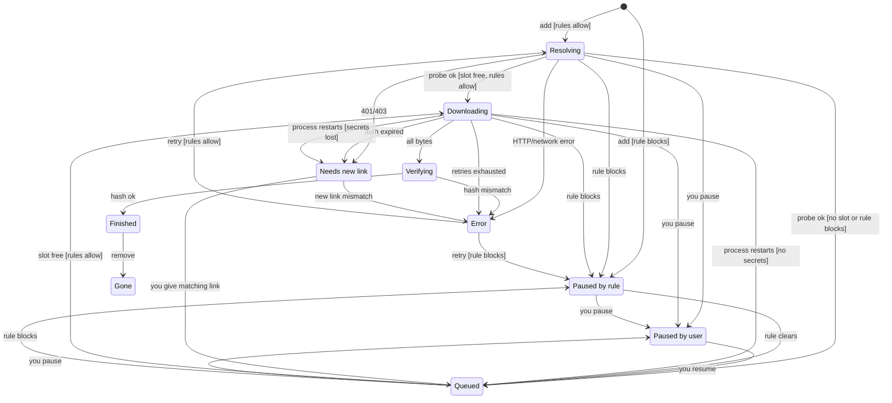

# Link downloads

A link download moves through `resolving`, `queued`, `downloading`, `paused`, `verifying`, `finished`, `needs_link`, `error`, and `gone` (`native/maglev-core/src/http_dl/machine.rs`). While each single row of `step(state, event)` has a Rust unit test, multi-step paths cross process death (which drops in-memory cookies and signed links), governance blocks, user pauses, and automatic retries.

The model checks that a download needing in-memory secrets never runs after process death until given a new link, a user pause survives governance clears, retries obey their budget, and downloading never runs while governance blocks.

Check it:

```bash
node scripts/check-models.js specs/link-downloads
```

## States

The chart shows the shipped design (`LinkDownloads.cfg`).



## Rules

Each rule is an invariant in `LinkDownloads.tla`. TLC checks it in every state it can reach.

| Rule | In plain words |
|---|---|
| `NoWorkWithoutSecrets` | A download that relies on in-memory cookies or a signed URL never resolves or downloads after process death until you supply a new link. |
| `UserPauseStaysPaused` | A download you paused never wakes up when a governance rule clears. |
| `RetryBudgetRespected` | Transient failures never exceed the retry budget without transitioning to **Error**. |
| `RespectsGovernance` | A download never actively downloads while a governance rule is blocking. |
| `TypeOK` | Every variable holds the kind of value its comment promises. |

## Designs tried

Each design is a `.cfg` that sets `DESIGN`. The rejected ones stay, with the rule they break, so `check-models.js` keeps proving why they were rejected.

| Design | What it did | Result |
|---|---|---|
| `LinkDownloads.cfg` | Shipped design (`machine.rs` + `driver.rs`): `SecretsLost` routes secret-bearing downloads to `NeedsLink` on restart, `GovClear` never wakes `Paused(User)`, and `attempts < MAX_ATTEMPTS` bounds retries. | All rules hold in all reachable states. |
| `RetryWithoutSecrets.cfg` | On process restart, queued secret-bearing downloads instead of emitting `SecretsLost`. | `NoWorkWithoutSecrets` breaks: a secret-bearing download is added, process restarts, and a free slot starts downloading without cookies/headers. |
| `GovClearWakesUserPause.cfg` | `GovClear` moved `Paused(User)` back to `Queued`. | `UserPauseStaysPaused` breaks: you pause a download while a rule is on, the rule clears, and the download queues again. |
| `InfiniteRetries.cfg` | Ignored `MAX_ATTEMPTS` on transient failures. | `RetryBudgetRespected` breaks: transient failures increment `attempts` past the budget without moving to `Error`. |

## Actions and the code they stand for

| Action | Code |
|---|---|
| `AddDownload` | `machine.rs` `Event::Add` / `Event::AddBlocked`. |
| `ProbeOk`, `ProbeAuth`, `ProbeFail` | `machine.rs` `Event::ProbeOk`, `Event::ProbeAuth`, `Event::ProbeStatus` / `NetErr`. |
| `SlotFree` | `machine.rs` `Event::SlotFree`. |
| `TransientFail`, `DownloadAuthFail` | `machine.rs` `Event::Transient` / `Event::Stalled`, `Event::Auth`. |
| `AllBytes`, `VerifyOk`, `VerifyBad` | `machine.rs` `Event::AllBytes`, `Event::HashOk`, `Event::HashBad`. |
| `YouPause`, `YouResume` | `machine.rs` `Event::UserPause`, `Event::UserResume`. |
| `GovTurnsOn`, `GovClears` | `machine.rs` `Event::GovBlock`, `Event::GovClear`. |
| `YouGiveNewLink` | `machine.rs` `Event::NewLink`. |
| `RetryFromError` | `machine.rs` `Event::UserRetry` / `Event::UserRetryBlocked` (and `AutoRetryWorker.kt`). |
| `ProcessRestarts` | `machine.rs` `Event::Restore` / `Event::SecretsLost` (`driver.rs` startup restore). |
| `YouRemove` | `machine.rs` `Event::Remove`. |

## What the model leaves out

- **Distinct `DlError` codes and stream muxing (`MuxFailed` / `RetryMux`):** all error codes share the same retry/remove transitions from `Error`; stream muxing is a self-loop `Verifying ↔ Error(MuxFailed)` that never touches the network.
- **Full `MAX_ATTEMPTS = 10` / `MAX_STALL_ATTEMPTS = 5`:** bounded to `MaxAttempts = 2` so TLC explores every state in under a second while proving the exact budget boundary.
- **Per-item "Resume anyway" override:** modelled in [`specs/transfer-rules/`](../transfer-rules/).
