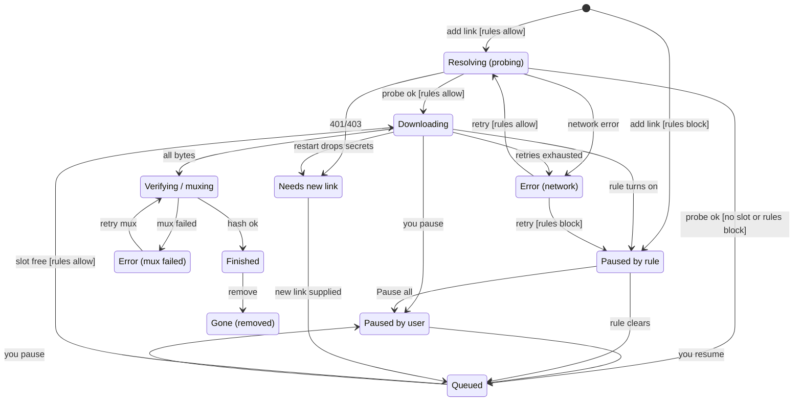

# Link downloads

Direct HTTP/HTTPS and stream downloads move through Rust's pure state machine (`http_dl/machine.rs`), driven by `http_dl/driver.rs` and Kotlin's background `AutoRetryWorker`. Process death drops in-memory cookies, passwords and signed links (`SecretsLost` → `needs_link`), governance rules can block and clear at any time, and user pauses must always win over governance clears and auto-retries.

The model checks every reachable path through `http_dl/machine.rs`, including process restarts, retry budgets, mux retries, and governance/user-pause races.

Check it:

```bash
node scripts/check-models.js specs/link-downloads
```

## States

The chart shows the shipped design (`LinkDownloads.cfg`).



## Rules

Each rule is an invariant in `LinkDownloads.tla`. TLC checks it in every state it can reach.

| Rule | In plain words |
|---|---|
| `UserPauseWins` | A download you paused never wakes up on a governance clear, process restore, or background auto-retry. |
| `NoTransferWithoutSecrets` | Once a restart drops in-memory cookies or a signed link, the download waits in `needs_link` and never resolves or downloads until you supply a new link. |
| `GovBlocksDownload` | While a governance rule blocks, no download actively transfers bytes. |
| `AttemptsBounded` | Transient retries never exceed `MAX_ATTEMPTS`. |
| `TypeOK` | Every variable holds the kind of value its comment promises. |

## Designs tried

Each design is a `.cfg` that sets `DESIGN`. The rejected ones stay, with the rule they break, so `check-models.js` keeps proving why they were rejected.

| Design | What it did | Result |
|---|---|---|
| `LinkDownloads.cfg` | Shipped design (`http_dl/machine.rs`): `SecretsLost` moves secret-bearing downloads to `needs_link` on restart, `Paused(User)` ignores `GovClear`, and `UserRetryBlocked` pauses retries while governance blocks. | All rules hold in all reachable states. |
| `RestoreIgnoresSecrets.cfg` | Treated a secret-bearing download like a plain download on restart (`Restore` → `queued` instead of `SecretsLost` → `needs_link`). | `NoTransferWithoutSecrets` breaks in 2 steps: add a secret link, process restarts, and it queues without its cookies/token. |
| `GovClearWakesUserPause.cfg` | Let `GovClear` resume `Paused(User)` along with `Paused(gov)`. | `UserPauseWins` breaks: a user-paused download wakes up into `queued` when governance clears. |
| `AutoRetryIgnoresGov.cfg` | Let a retry from `Error(Network)` jump straight to `downloading` even while governance blocks. | `GovBlocksDownload` breaks: a failed download starts transferring while a governance rule is active. |

## Actions and the code they stand for

| Action | Code |
|---|---|
| `Add` | `http_dl/machine.rs` `Event::Add` / `Event::AddBlocked`. |
| `ProbeOk`, `ProbeAuth`, `ProbeNetErr` | `http_dl/machine.rs` `Event::ProbeOk`, `Event::ProbeAuth`, `Event::NetErr`. |
| `SlotFree`, `TransientFail`, `AllBytes` | `http_dl/machine.rs` `Event::SlotFree`, `Event::Transient`, `Event::AllBytes`. |
| `HashOk`, `MuxFailed`, `RetryMux` | `http_dl/machine.rs` `Event::HashOk`, `Event::MuxFailed`, `Event::RetryMux`. |
| `UserPause`, `UserResume` | `http_dl/machine.rs` `Event::UserPause`, `Event::UserResume`. |
| `GovTurnsOn`, `GovTurnsOff` | `http_dl/machine.rs` `Event::GovBlock`, `Event::GovClear`. |
| `RetryError` | `http_dl/machine.rs` `Event::UserRetry` / `Event::UserRetryBlocked` (`AutoRetryWorker.kt` + UI Retry). |
| `NewLink` | `http_dl/machine.rs` `Event::NewLink`. |
| `ProcessRestart` | `http_dl/machine.rs` `Event::SecretsLost` / `Event::Restore`. |
| `Remove` | `http_dl/machine.rs` `Event::Remove`. |

## What the model leaves out

- **Fatal probe/transfer errors (`HttpFatal`, `NotAFile`, `LocalRedirect`, `LanAddress`, `FileTooLarge`, `StreamProtected`):** all transition to `Error(_)` with the same retry/remove semantics as `error_net`.
- **`MAX_ATTEMPTS = 10` and `MAX_STALL_ATTEMPTS = 5`:** scaled to `MaxAttempts = 2` so TLC explores every boundary (below limit, at limit, and reset on retry) in under a second.
- **Multiple concurrent downloads competing for slots:** slot contention is modelled in [`specs/torrents/`](../torrents/); here `SlotFree` models waiting for a slot.
