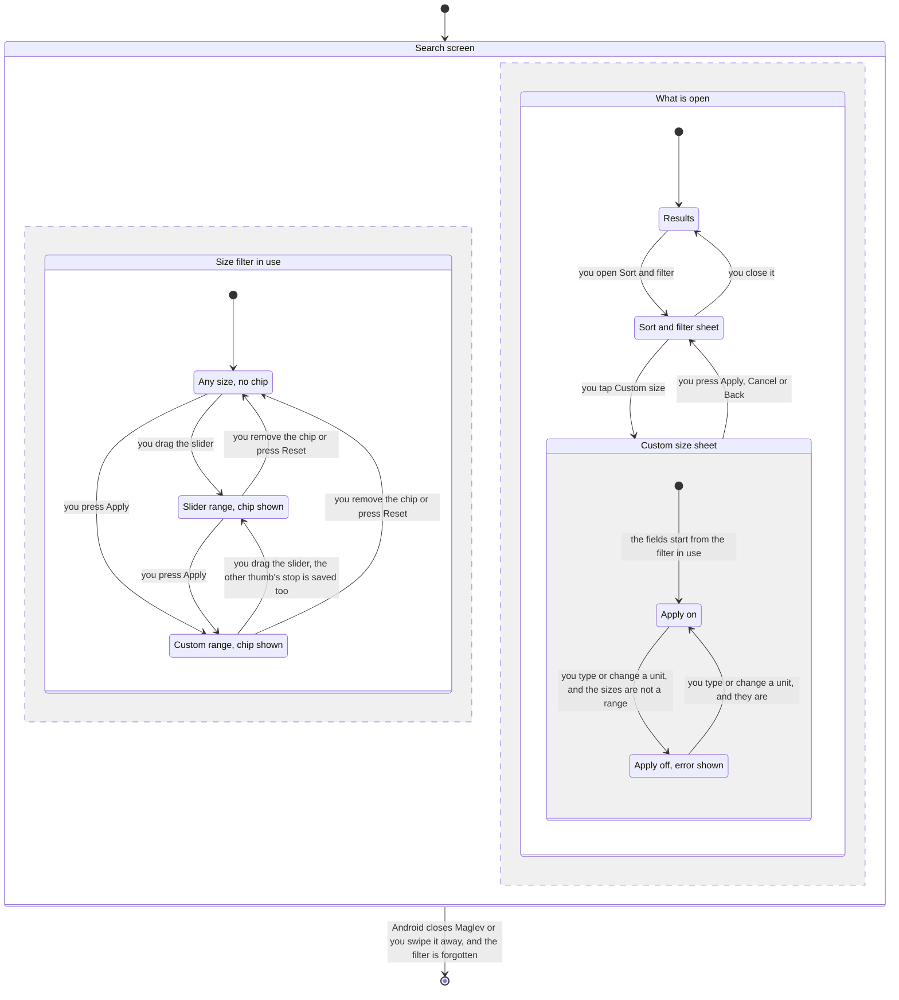

# Search size filter

On Search you can limit results by size. The slider picks a range between fixed stops. Under it, "Custom size" opens a sheet with a Smallest and a Largest field, each with a KB, MB, GB or TB switch, and Apply and Cancel. While a size filter is set, a chip above the results shows it, and removing the chip clears it. The filter lasts until Maglev closes.

The model checks three things that are easy to get wrong in that sheet: what you type must not move the results until you press Apply, Apply must never save a range that is the wrong way round, and the slider and the Custom sheet must not leave a filter that the thumbs don't show.

Check it:

```bash
node scripts/check-models.js specs/search-size-filter
```

## Goal

You can filter Search results to any size range, not only the slider's stops, and the results you see always match the filter the chip names.

## States

The chart shows the design that passes (`SizeFilter.cfg`). The source is [`chart.mmd`](chart.mmd). The two regions run side by side: the filter in use, and which sheet is open.



- Apply with sizes that land exactly on stops gives the same filter as the slider. The filter holds bytes, not stop positions, so there is nothing to tell them apart.
- Apply with both fields empty is Any size.
- A new search keeps the filter. Switching tabs keeps the Search screen alive, so it keeps the filter too.

## Rules

Each rule is an invariant in `SizeFilter.tla`.

| Rule | In plain words |
|---|---|
| `SizeBounds` | With a size filter set, every result of known size on screen is inside it. Results of unknown size always show. |
| `DraftNeverFilters` | The results always follow the filter in use, never the Custom size fields. Typing changes no result; only Apply does. |
| `NoInvertedRange` | A filter in use always has its smallest size below its largest when both are set. |
| `SliderWritesStops` | After you drag the slider, both ends of the filter sit on the slider's stops, so the thumbs show the filter exactly. |
| `TypeOK` | Every variable holds the kind of value its comment promises. |

`NoCustomRange` in the `.tla` is not a rule. `Reach.cfg` expects it to break, which proves that a custom range off the stops can be applied at all. Without it, the rules could pass on a model where Apply never happens.

## Designs tried

| Design | What it did | Result |
|---|---|---|
| `SizeFilter.cfg` | The Custom sheet edits its own fields. Apply is on only when they make a range, and saves them. Cancel and Back drop them. Dragging a thumb saves both thumbs' stops. | All rules hold in all 118,272 reachable states. |
| `LiveDraft.cfg` | The results follow the fields while you type. | `DraftNeverFilters` breaks in 4 steps: you open Sort and filter, tap Custom size, type a Largest size, and a result above it arrives. It stays hidden though you never pressed Apply, and the chip still says Any. |
| `AcceptInverted.cfg` | Apply stays on when Smallest is not below Largest, and saves the sizes as typed. | `NoInvertedRange` breaks in 5 steps: you open Sort and filter, tap Custom size, type the same size in both fields, and press Apply. Only results of exactly that byte count can show, so almost every result is hidden. With Smallest above Largest, every result of known size is hidden. |
| `Swap.cfg` | Apply swaps the two sizes when they are the wrong way round. | `NoInvertedRange` breaks in 5 steps, on the same path: equal sizes can't be swapped into a range. |
| `KeepsCustom.cfg` | Dragging one thumb saves only that thumb; a custom size on the other side stays. | `SliderWritesStops` breaks in 5 steps: you open Sort and filter, tap Custom size, type a Smallest size between two stops, press Apply, and drag the high thumb. The low thumb sits on a stop, but the filter still uses the typed size. |
| `Reach.cfg` | The passing design, checked for reach. | `NoCustomRange` breaks in 4 steps, as it must: a custom size can be applied. |

## Actions and the code they stand for

Paths are under the repo root. `SortFilterSheet` is `components/search/SortFilterSheet.tsx`, `CustomSizeSheet` is `components/search/CustomSizeSheet.tsx`, `sizeRange` is `components/search/sizeRange.ts`, and `search` is `app/(tabs)/search.tsx`.

| Action | Code |
|---|---|
| `YouOpenFilters`, `YouCloseFilters` | `search`: `sortOpen` state, set by the Sort button and by `SortFilterSheet`'s `onClose`. |
| `YouDragMin`, `YouDragMax` | `SortFilterSheet`: `RangeSlider` `onChange(low, high)` calls `onSizeFilterChange(toFilter(low, high))`. The thumbs come from `stopsFor(sizeFilter)`, so the other end is written as the stop its thumb shows. `search` keeps the result in `sizeFilter`. |
| `YouOpenCustom` | `SortFilterSheet`: the "Custom size" button sets `customOpen`. `CustomSizeSheet` fills its fields from `sizeFilter` on open (`fieldFor`). |
| `YouType`, `YouChangeUnit` | `CustomSizeSheet`: `minText`, `minUnit`, `maxText`, `maxUnit` state only. `readSize` and `checkCustomSize` in `sizeRange` turn them into bytes or an error. Nothing reaches `search`, so `shown` cannot change. |
| `YouApply` | `CustomSizeSheet`: Apply is disabled unless `checkCustomSize(...).filter` is set. It calls `onApply(filter)`, and `SortFilterSheet` passes it to `onSizeFilterChange` and closes the sheet. The order check runs on rounded bytes inside `checkCustomSize`. |
| `YouCancel` | `CustomSizeSheet`: Cancel and Android Back call `onClose`. The fields are rebuilt from `sizeFilter` the next time it opens. |
| `YouRemoveChip` | `components/search/SizeFilterChip.tsx`, shown in `search` while `hasSizeFilter(sizeFilter)`. Its `onRemove` calls `setSizeFilter({})`. |
| `YouReset` | `search`: `onReset` calls `setSizeFilter({})`. `SortFilterSheet` shows Reset only when `dirty` (a source picked, a size set, or no-one-sharing off). |
| `YouSearchAgain` | `search`: no code touches `sizeFilter` when a search starts. |
| `ResultArrives` | `search`: `shown` is a `useMemo` over `update.results` and `sizeFilter`; it filters through `passesResultFilter` in `components/search/sharing.ts`, which lets unknown sizes through. |
| `MaglevCloses` | Android does this, or you swipe Maglev away. No Maglev code runs; the filter lives only in the Search screen's memory. |


## Out of scope

- Saving the filter as a setting. It stays session-only, as it is today.
- Decimal units (1 KB = 1000 B). Units are binary, the same as the sizes Maglev shows everywhere else.
- Changing the slider's stops.

## What the model leaves out

- **Units.** KB, MB, GB and TB only turn the text in a field into bytes. In the model a field can become any byte value, empty, or unreadable, which covers every unit, every rounding and the 1024 TB cap. Reading the text is a pure function with its own checks. The rules hold only if the code checks Smallest below Largest on the final bytes, after rounding and the cap: "1.0001 KB" and "1.0002 KB" round to the same byte count.
- **Real sizes.** Sizes are the numbers 1 to 5, with stops at 2 and 4. That gives a size below, between and above the stops, and both open ends. TLC has not checked more stops.
- **Which stop a thumb shows for a custom size.** The model lets it be the nearest stop below or above, so any way of picking "nearest" is covered.
- **Sort, source filter and Hide dead.** They change which results show but don't touch the size filter.
- **Where Apply and Cancel go.** The model returns to the Sort and filter sheet. Closing both sheets instead would change nothing the rules check.

## On a phone

Each path TLC found is a sequence to try on the shipped build. Each rule must hold.

1. **Typing doesn't filter** (the `LiveDraft` path). Search "dune" and, while sources are still answering, open Sort and filter, tap Custom size and type 500 MB in Largest. Don't press Apply. Results above 500 MB keep showing and arriving, and no chip appears. Press Cancel: the results are unchanged.
2. **No inverted range** (the `AcceptInverted` and `Swap` path). Open Sort and filter, tap Custom size, type 2 GB in both fields. The error "Smallest must be less than largest" shows and Apply is off. Then try 5 GB and 2 GB: the same.
3. **The slider shows the filter** (the `KeepsCustom` path). Apply Custom size Smallest 700 MB, Largest empty: the chip says "Over 700 MB". Drag the high thumb to 2 GB. The chip and the results now match the two thumbs exactly; no result between the low thumb's stop and 700 MB is still hidden.
