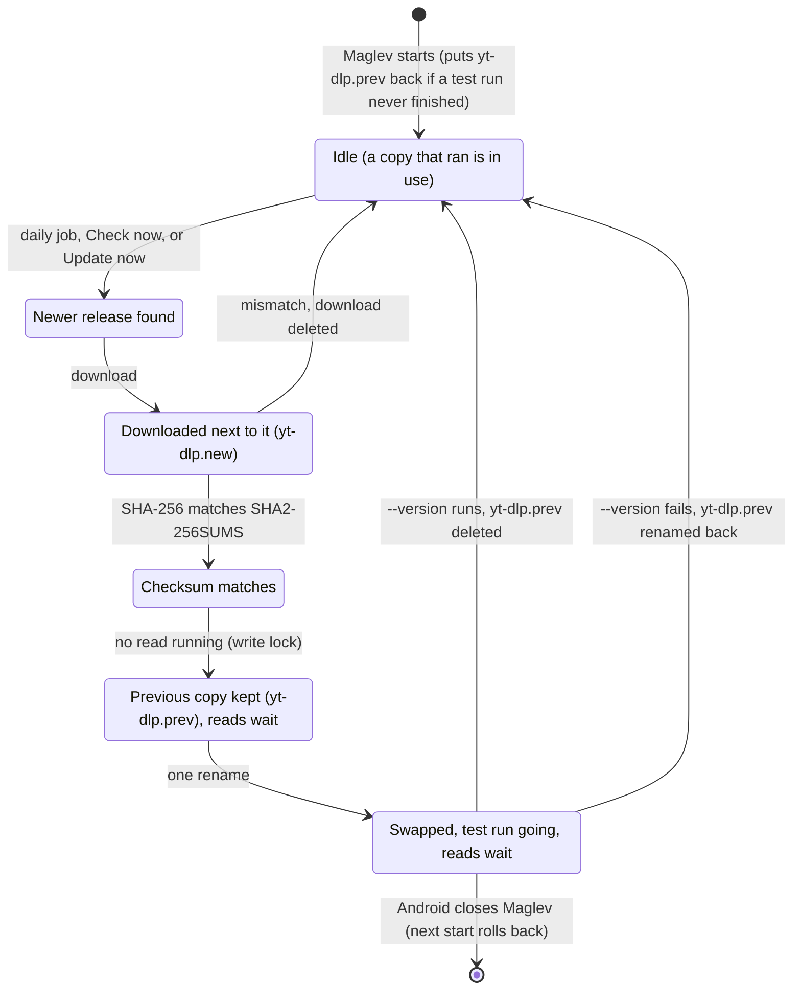
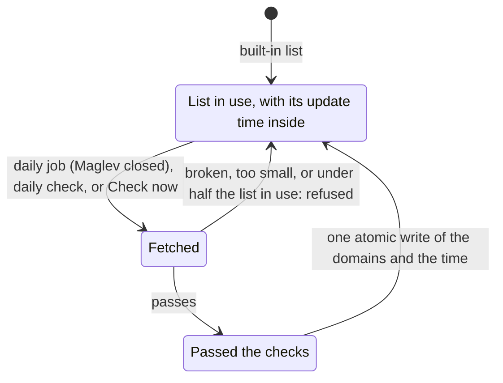

# Parts that update themselves: yt-dlp and the ad block list

## Goal

If nobody ships a Maglev release for months, installed apps keep working. Video links depend on yt-dlp, which sites break every few weeks, and ad blocking depends on upstream lists. Both now update straight from their own sources, with Maglev open or closed, and no Maglev server or release in the loop:

- **yt-dlp** comes from yt-dlp's own GitHub release files. Maglev checks each download against the release's `SHA2-256SUMS`, swaps it in only when no video is being read, runs it once, and puts the previous copy back if it doesn't run on the app's Python.
- **The ad block list** comes from its upstream addresses once a day, in a WorkManager job that runs with Maglev closed. A list that fails a check, or arrives cut short, never replaces the one in use. "Updated 3 h ago" is the time the list passed its checks, written inside the list file, never a file's modification time (which gave "Updated 57 y ago" after a restore).

Two models, one folder:

```bash
node scripts/check-models.js specs/self-updating-parts
```

## States

The yt-dlp update, as shipped (`YtDlpUpdate.cfg`):



The ad list update, as shipped (`ListUpdate.cfg`):



## Rules

| Rule | In plain words |
|---|---|
| `NeverRunUnverified` | A read only runs a yt-dlp whose SHA-256 matched the release's sums, or the one that came inside the app. |
| `NoReadSeesHalfSwap` | While a read runs, the file at yt-dlp's path is the whole copy it opened. Python opens the yt-dlp zip again by name for every module it loads, so a swap under a read would break it. |
| `AlwaysAWorkingCopy` | The newest copy that has worked is always on disk: in use, or kept to roll back to. A failed or broken update leaves it. |
| `ReadsRunAWorkingCopy` | A read only runs a copy that works on the app's Python. |
| `KeepLastGood` | The ad list in use passed every check. A failed, broken or cut-short update leaves the last good one. |
| `TimeIsReal` | The "Updated" time is when the list in use passed its checks, never a file's modification time. |
| `TypeOK` | Every variable holds the kind of value its comment promises. |

## Designs tried

| Design | What it did | Result |
|---|---|---|
| `YtDlpUpdate.cfg` | Shipped: checksum, keep `yt-dlp.prev`, swap and test-run under the write lock, roll back on failure and at start-up. | All rules hold in all 68 reachable states. |
| `TodayUnverified.cfg` | Maglev 1.0: the library's `updateYoutubeDL` installs the download without checking it. | `NeverRunUnverified` breaks in 6 steps: Maglev gets ready, finds a newer release, the download arrives damaged, the library deletes the old copy and copies the damaged one in, and you open a video link. |
| `TodayHalfSwap.cfg` | Maglev 1.0: the library deletes the yt-dlp folder, then copies the new file in. | `NoReadSeesHalfSwap` breaks in 5 steps: you open a video link, the daily job finds and downloads a release, and deletes the file the read is running. |
| `TodayNoRollback.cfg` | Maglev 1.0: nothing keeps the copy in use. | `AlwaysAWorkingCopy` breaks in 4 steps: the folder is deleted before the new copy is in place. If Android closes Maglev here, the library puts back its built-in copy, a year behind the sites. |
| `NoLock.cfg` | Checksum, `yt-dlp.prev` and rollback, but the swap doesn't wait for a running read. | `NoReadSeesHalfSwap` breaks in 7 steps: you open a video link, and the rename lands while it runs. |
| `UnlockBeforeTest.cfg` | Reads may start again right after the rename, before the test run. | `ReadsRunAWorkingCopy` breaks in 7 steps: a release that fails on the app's Python is swapped in and you open a video link before the test run ends. |
| `NoStartupRollback.cfg` | The rollback happens only when the test run fails, not at start-up. | `ReadsRunAWorkingCopy` breaks in 10 steps: a broken release is swapped in, Android closes Maglev during the test run, Maglev starts, and your next video link runs the broken copy. |
| `ListUpdate.cfg` | Shipped: refuse a list under half the size of the one from the same addresses; the time goes inside the list file. | All rules hold in all 141 reachable states. |
| `ListsTodayTime.cfg` | Maglev 1.0: Settings shows the list file's modification time. | `TimeIsReal` breaks in 5 steps: the list updates, Android closes Maglev, and a backup restore writes the file back with time 0 ("Updated 57 y ago") or the restore's time. |
| `ListsTodayCut.cfg` | Maglev 1.0: a list that still has over 1,000 names is used, however much it shrank. | `KeepLastGood` breaks in 6 steps: a good list is in use, then the server sends one cut short and it replaces the good one. |
| `TimeInMeta.cfg` | The update time in `blocklist.json`, a second write after the list file. | `TimeIsReal` breaks in 3 steps: the new list is written and its time not yet. If Android closes Maglev there, the old time stays with the new list. |

## Actions and the code they stand for

`KT/` is `modules/maglev-engine/android/src/main/java/com/maglev/engine/`.

| Action | Code |
|---|---|
| `MaglevGetsReady` | `KT/videosites/VideoSites.kt` `ensureInit`: `YtDlpInstall.recover` (renames `yt-dlp.prev` back, deletes `yt-dlp.new`) under the write lock, then `YoutubeDL.init`, which copies the built-in copy only when the path is empty. |
| `ReadStarts`, `ReadEnds` | `VideoSites.resolve`: `YtDlpInstall.reading { YoutubeDL.execute(...) }` (read lock). |
| `CheckFindsNewer` | `VideoSites.update` → `YtDlpRelease.latest` (the redirect of `releases/latest/download/SHA2-256SUMS` names the tag; the sums file gives the `yt-dlp` hash), compared with `YtDlpInstall.runningSha256`. Equal: `current`. A hash that already failed its test run (`badSha`): skipped. Callers: `VideoSitesUpdateWorker` (daily and "soon"), the module's `videoSitesUpdate` (Check now, the card's Update, the add screen's Update now). |
| `Download` | `YtDlpRelease.download` into `yt-dlp.new` in the same folder, with connect and read timeouts, a size cap and a free-space check, synced to disk. |
| `ChecksumChecked` | `VideoSites.update`: `got != latest.sha256` deletes the download. |
| `KeepPrevious` | `YtDlpInstall.install`: `writeLock().tryLock(2 min)`, then the copy in use is copied to `yt-dlp.prev.tmp`, synced, renamed to `yt-dlp.prev`. |
| `Swap` | `YtDlpInstall.install`: `Os.rename(yt-dlp.new, yt-dlp)`. |
| `TestRunPasses`, `TestRunFailsRollBack` | `YtDlpInstall.testRun` (`yt-dlp --version` through `YoutubeDL.execute`, stopped after 60 s with `destroyProcessById`; must print the version read from the zip). Pass: delete `yt-dlp.prev`, record `installedSha`. Fail: rename `yt-dlp.prev` back, record `badSha`. |
| `TodayDeletesOld`, `TodayCopiesNew` | Rejected design: youtubedl-android 0.18.1 `YoutubeDLUpdater.update` (`FileUtils.deleteDirectory`, then `FileUtils.copyFile`). No longer called. |
| `Fetch` | `KT/lists/ListsUpdateWorker.kt` (daily, unmetered, Maglev closed) and the app's own check (`utils/lists/index.ts` `updateAdList`, `runListCheck`) → `KT/browser/BlocklistStore.kt` `update` → `fetchOrMirror` (a raw.githubusercontent.com address falls back to its jsDelivr copy). |
| `Check` | `BlocklistStore.update`: `BlocklistParser.requireEnough` and the size caps (as before), and the new rule: same addresses and under half the domains of the list in use throws `LIST_INVALID`. The signed sources file: `utils/lists/check.ts` (signature, schema, serial), unchanged. |
| `WriteList` | `BlocklistStore.update`: the list file with `# updated-at: <ms>` as its second line, written by `writeAtomic` (temp file, fsync, rename). `load` reads the time back with `updatedAtOf`. |
| `WriteMeta` | Rejected design. `blocklist.json` still holds the addresses and the ETag/Last-Modified values; a kill before it is written only costs one full fetch next time. |
| `TimePasses`, `AndroidKillsMaglev`, `MaglevStarts`, `AndroidRestoresBackup` | Android does these. No Maglev code runs. WorkManager starts Maglev's process for the daily jobs. |

## What the models leave out

- **Network rules.** "Update on mobile data" is the WorkManager constraint on the yt-dlp job (unmetered unless it's on); the ad list job always needs an unmetered network. Wi-Fi only and VPN only are checked before any download (`BrowserGovernance.blockedReason`). Check now and Update now are the person's own request, so they may use mobile data. Guards on when an update may start can't break a rule about what it does.
- **Several reads at once.** The read lock is shared, so many reads behave as one for the swap.
- **Two updates at once.** `VideoSites.update` and `BlocklistStore.update` are each `synchronized`, so the model has one updater.
- **Which release is newest.** The model picks any release that differs from the file. The code compares SHA-256 values, so a restored or crashed state where a saved tag and the file disagree can't arise: there is no saved tag.
- **The signed sources file in the background.** It updates when Maglev opens, as before, because its schema check and its store live in the app's JavaScript. It already keeps the last good file (signature and serial rules). Without new ones, the app keeps the last file it had.
- **A newer built-in yt-dlp.** The library's built-in copy (2025.11.12) stays. A fresh install gets the newest one on its first update; until then a failed read says so and offers Update now.
- **Power loss.** Every file that is renamed into place is synced first; the model only has process death, where unsynced data survives anyway.

## On a phone

1. **Fresh install on mobile data.** Install, turn Wi-Fi off, keep "Update on mobile data" off. Share a YouTube link. If the read fails, the add screen says video support still runs the version that came with the app and offers **Update now**. Tap it: it downloads over mobile data (you asked), then reads the link. Settings › Updates › Video site reader shows the new version and "checked just now". Before tapping, `adb shell run-as com.maglev ls files/../no_backup/youtubedl-android/yt-dlp/` shows only `yt-dlp`, and no mobile data is used by the background job.
2. **Kill during a swap.** Put the built-in copy back so the next check downloads: `adb shell run-as com.maglev rm no_backup/youtubedl-android/yt-dlp/yt-dlp no_backup/maglev-video-sites.json`, open a video link once (the library copies its built-in copy in), then tap Settings › Updates › Video site reader › Check now and run `adb shell am kill com.maglev` a few seconds later; repeat with different delays. Reopen and read a video link: it works, with the old copy or the new one. `adb shell run-as com.maglev ls no_backup/youtubedl-android/yt-dlp/` shows only `yt-dlp`.
3. **A broken yt-dlp rolls back.** Leave the state a kill during a failed test run would leave: `adb shell run-as com.maglev sh -c 'cd no_backup/youtubedl-android/yt-dlp && cp yt-dlp yt-dlp.prev && echo broken > yt-dlp'`, then `adb shell am force-stop com.maglev`. Reopen and read a video link: it works, `ls` shows no `yt-dlp.prev`, and `adb logcat -s MaglevVideoSites` shows "start-up: put the previous yt-dlp back". The rollback after a failed test run is the same rename, logged as "the new yt-dlp failed its test run; the previous one is back"; a real release that fails on the app's Python can't be produced on cue, so that line is checked in the log when it happens.
4. **Lists update with the app closed.** Turn on "Update lists automatically", swipe Maglev away, stay on Wi-Fi. `adb shell dumpsys jobscheduler | grep -A3 maglev` lists the job; force it with `adb shell cmd jobscheduler run -f com.maglev <job id>`, or wait a day. Open Settings › Updates: the ad list says "updated" with the time the job ran, and `adb logcat -s MaglevLists` shows "background list check".
5. **"Updated" time is right.** After step 4, `adb shell run-as com.maglev head -2 files/browser/blocklist.txt` shows `# updated-at: <ms>` matching the Settings line. Then `adb shell run-as com.maglev touch -t 197001010000 files/browser/blocklist.txt`, kill and reopen: Settings still shows the same time, not "57 y ago".
