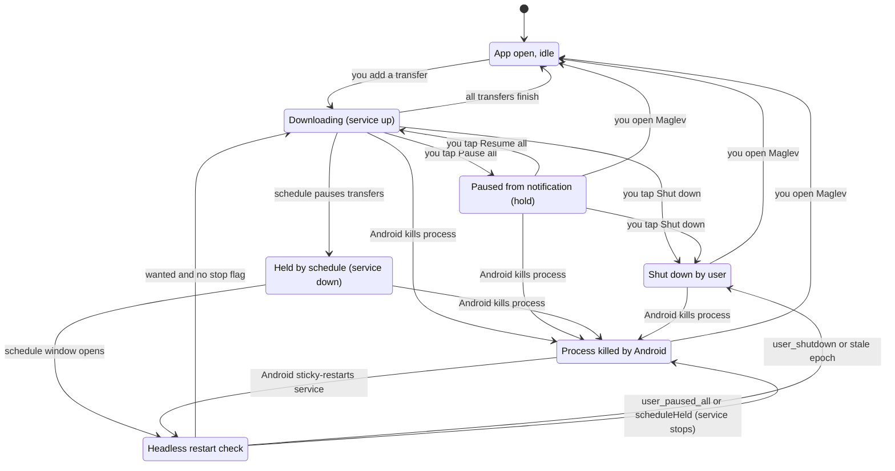

# Background service and restart

Maglev keeps downloads running in a foreground service (`MaglevTorrentService`) after you leave the app. Android can kill the process in the background and restart the service later (`START_STICKY`), or a schedule alarm can wake it up, while you tap **Pause all** or **Shut down** on the notification.

The model checks that a headless restart never brings back transfers you stopped, never starts the engine after **Pause all** and process death, never keeps the foreground service running while the schedule holds transfers, and never leaves a foreground notification up with no engine behind it.

Check it:

```bash
node scripts/check-models.js specs/service-restart
```

## States

The chart shows the design that passes (`ServiceRestart.cfg`).



## Rules

Each rule is an invariant in `ServiceRestart.tla`. TLC checks it in every state it can reach.

| Rule | In plain words |
|---|---|
| `ShutdownStaysStopped` | After you tap **Shut down**, nothing starts headlessly until you start work again (opening Maglev starts the engine in foreground without clearing `user_shutdown`). |
| `PausedAllStaysStopped` | After you tap **Pause all** with no active, rule-paused or schedule-paused work left, once the notification hold is gone (for example after Android kills the process), `service_wanted` stays false, the service stays stopped, and a headless restart never starts the engine. |
| `ScheduleHoldStopsService` | While the schedule holds transfers (and no active, rule-paused or notification-held work keeps the service up), the foreground service does not stay running. |
| `NoOrphanService` | Once any pending headless check has finished, the foreground service never stays up without a running engine. |
| `MemoryDiesWithProcess` | In-memory flags and queued coroutines are cleared whenever Android kills the process. |
| `TypeOK` | Every variable holds the kind of value its comment promises. |

## Designs tried

Each design is a `.cfg` that sets `DESIGN`. The rejected ones stay, with the rule they break, so `check-models.js` keeps proving why they were rejected.

| Design | What it did | Result |
|---|---|---|
| `ServiceRestart.cfg` | `lifecycleLock` + `shutdownEpoch` guard queued headless starts, `RestartPolicy.decide` honours `user_shutdown` / `user_paused_all` / `scheduleHeld`, and `holdForPaused` keeps the notification visible without setting `service_wanted` or clearing `user_paused_all`. | All rules hold in all 942 reachable states. |
| `HoldClearsPaused.cfg` | `driveService` included `holdForPaused && pausedByUser > 0` in `setWanted(true)`, which cleared `user_paused_all` right after notification **Pause all**. | `PausedAllStaysStopped` breaks in 5 steps: you add a transfer, tap Pause all on the notification, the next poll sets `service_wanted = true` and clears `user_paused_all`, you go home, and Android kills the process with `service_wanted` still true (so a sticky restart would spin the engine back up headlessly). |
| `NoEpochGuard.cfg` | A `headlessStart` queued before **Shut down** runs without checking `shutdownEpoch`. | `ShutdownStaysStopped` breaks in 5 steps: the schedule pauses and re-opens (queuing `headlessStart`), you tap Shut down, and the stale coroutine starts the engine anyway. |
| `NoIntentFlags.cfg` | `headlessStart` restarts whenever saved transfers exist, ignoring `user_shutdown`, `user_paused_all` and `scheduleHeld`. | `ScheduleHoldStopsService` breaks in 5 steps: the schedule pauses, re-opens, pauses again before the queued `headlessStart` runs, and the restart ignores `scheduleHeld` and keeps the foreground service running. |

## Actions and the code they stand for

| Action | Code |
|---|---|
| `YouAddWork`, `WorkFinishes` | `EngineHost.kt` `addTorrent` / `pollLocked` (`summarize` + `driveService`). |
| `RulePausesWork`, `RuleClearsWork` | `EngineHost.kt` `evaluateGovernance` (transfers paused by Wi-Fi / VPN / battery / offline still count as real work in `driveService`). |
| `YouOpenApp` | `EngineHost.kt` `init` + `onForeground` (starts engine and clears `holdForPaused`, without clearing `user_shutdown`). |
| `YouPauseAllFromNotification` | `MaglevTorrentService.kt` `ACTION_PAUSE_ALL` / `MaglevTileService.kt` → `EngineHost.kt` `pauseAllFromNotification` → `engineReadyForAction` + `pauseAll` (starts engine if dead, sets `user_paused_all`, clears `service_wanted`, sets `holdForPaused = true`). |
| `YouResumeAllFromNotification` | `MaglevTorrentService.kt` `ACTION_RESUME_ALL` / `MaglevTileService.kt` → `EngineHost.kt` `resumeAllFromNotification` → `engineReadyForAction` + `resumeAll` (starts engine if dead, clears `holdForPaused`). |
| `PollAndDriveService` | `EngineHost.kt` `driveService` + `setWanted`. |
| `SchedulePauses` | `EngineHost.kt` `driveService` (`SCHEDULE_STOP_DELAY_MS` → `ScheduleManager.setHeld(c, true)` + `stopService`). |
| `ScheduleWindowOpens` | `ScheduleReceiver.kt` → `MaglevTorrentService.kt` `ACTION_SCHEDULE_RESUME` → `EngineHost.kt` `scheduleResume`. |
| `YouShutdown` | `MaglevTorrentService.kt` `ACTION_SHUTDOWN` → `EngineHost.kt` `shutdownFromNotification` → `shutdownEngineLocked` + `finishAppTasks` (increments `shutdownEpoch`, sets `user_shutdown`). |
| `RunQueuedHeadless` | `EngineHost.kt` `headlessStartLocked` + `RestartPolicy.kt` `RestartPolicy.decide`. |
| `YouGoHome`, `AndroidKillsProcess`, `AndroidStickyRestart` | Android does these (`START_STICKY` null-intent restart in `MaglevTorrentService.onStartCommand`). |

## What the model leaves out

- **Boot and package-replaced receivers (`BootReceiver.kt`, `RestartEntryPolicy.plan`):** they feed the same `RestartPolicy.decide` flags and `ACTION_RESTART` → `headlessStart(countKill = false)`. The Android 15 `dataSync` boot restriction only decides whether to post a "Tap to continue" reminder instead of calling `startForegroundService`.
- **Android 15 `dataSync` 6-hour timeout (`onTimeout` / `KEY_FGS_TIMEOUT`):** stops the service unconditionally until the user opens the app.
- **Per-transfer counts:** the model tracks whether any active, rule-paused, user-paused, or schedule-paused transfer exists (`hasActive`, `hasRulePaused`, `hasUserPaused`, `hasSchedPaused`) rather than exact counts. One transfer of each kind exercises mixed states and every restart race.
- **Timers and throttles:** the 10 s schedule grace, 10 s service retry throttle, and 2 s notification throttle affect timing, not which states are reachable.

## On a phone

The `HoldClearsPaused` path reproduces the bug fixed alongside this model:

1. Start a download and go home so the foreground notification is visible.
2. Tap **Pause all** on the notification (the notification stays up showing **Resume all** and **Shut down**).
3. Wait 2 seconds for a telemetry poll, then run `adb shell am kill com.maglev`.
4. With the fix, `user_paused_all` stays `true` and `service_wanted` stays `false`, so Android's sticky restart stops the service immediately without starting the engine.
