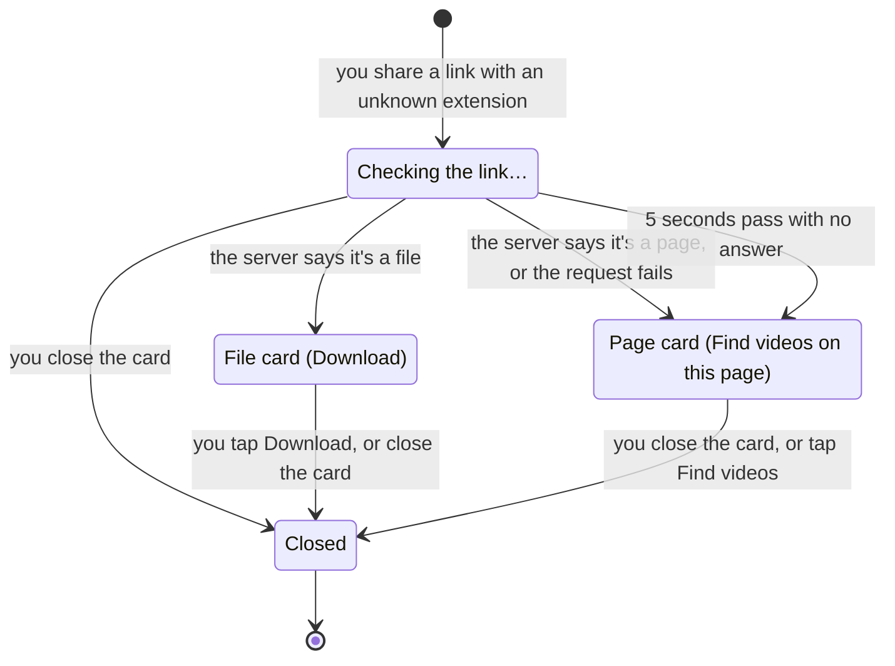

# Share card: links with an unknown extension

When you share a link to Maglev, the share card decides what it is. A magnet, a `.torrent` or a link whose name ends in a known file extension (`.zip`, `.mp4`, `.iso`…) is easy. A link like `https://proof.ovh.net/files/10Mb.dat` or `https://example.com/get?id=5` isn't: its text says nothing. Before 1.1 the card called every such link a web page, so a real file couldn't be downloaded from the card (issue #235). Pasting the same link into Add a link worked, because that screen asks the server.

Now the card asks the server too, with the same request, and waits at most 5 seconds. The model checks that the card never offers Download for a page, never gets stuck on "Checking the link…", and changes nothing once you close it.

Check it:

```bash
node scripts/check-models.js specs/share-card
```

## States

The chart shows the design that shipped (`ShareCard.cfg`).



An answer that arrives after the card stopped waiting (after 5 seconds, or after you closed it) changes nothing.

## Rules

Each rule is an invariant in `ShareCard.tla`. TLC checks it in every state it can reach.

| Rule | In plain words |
|---|---|
| `NoDownloadForPage` | Download is never offered, or started, for a link the server called a page or didn't answer for. |
| `QuietAfterClose` | A closed card waits for nothing, so no late answer can change it or start a download. |
| `NeverStuck` | After 5 seconds the card no longer says "Checking the link…". |
| `FileOffered` | A link the server calls a file, within 5 seconds, is offered as a file. |
| `TypeOK` | Every variable holds the kind of value its comment promises. |

## Designs tried

| Design | What it did | Result |
|---|---|---|
| `Today.cfg` | Maglev 1.0. The card decides from the link text alone and shows the page card at once. | `FileOffered` breaks in 1 step: you share `10Mb.dat`, the server would call it a file, and the card says "This is a web page, not a file". |
| `WaitsForever.cfg` | The card asks the server and waits for the answer, however long the engine takes to start and the server takes to reply. | `NeverStuck` breaks in 2 steps: you share a link to a slow server and 5 seconds pass with the card still checking. |
| `ShareCard.cfg` | The card asks, waits at most 5 seconds, and stops waiting when it closes. | All rules hold in all 20 reachable states. |

## Actions and the code they stand for

All files are under `modules/maglev-engine/android/src/main/java/com/maglev/engine/share/`.

| Action | Code |
|---|---|
| `YouShare` | `QuickShareActivity.onCreate`: a `WEB_PAGE` classification from `ShareClassify.classifyFirst` that isn't a video site and doesn't come from a BROWSABLE VIEW sets `checking` and calls `askServer`. `stateNow` shows `QuickShareText.CHECKING` while `checking` is true. |
| `ServerAnswers` | The worker in `askServer` starts the engine (`QuickShareAdd.startEngine`) and calls `QuickShareAdd.askServer`, which calls `EngineHost.probeUrl`, the request Add a link makes. `onServerAnswer` runs on the main thread and does nothing unless `checking` is still true. A file answer replaces `cls` with a `FILE_LINK` and runs `settle` (duplicate and space checks). Anything else leaves the page card. |
| `FiveSecondsPass` | The `giveUp` runnable, posted for `ASK_MS` (5 s). If the card is still checking, it clears `checking` and shows the page card. The probe's own timeout is the time left of the same 5 s. |
| `YouClose` | `finish()` from Close, the X, a tap outside the card, Back, or Find videos (`openMaglev`). `onDestroy` clears `checking` and removes `giveUp`, so a late answer is dropped. |
| `YouTapDownload` | `QuickShareActivity.download` → `QuickShareAdd.add` → `EngineHost.addDownload`. It is reachable only from the file card. |
| `Done` | No code. The card is gone. |

## What the model leaves out

- The request can't be interrupted once it is sent. After you close the card, it ends on its own timeout (the time left of the 5 seconds), and its answer is dropped. "Waits for nothing" in `QuietAfterClose` means the card no longer listens, not that the request stopped.
- What counts as "a file". The engine decides: a response with an HTML content type (`text/html`, `application/xhtml+xml`) is a page, even with `Content-Disposition: attachment`, because the download refuses the same responses. Any other 200 or 206 is a file. The model takes the answer as given.
- Redirects, sign-in pages and errors. The engine follows redirects; a 403, a 404 or a sign-in page all end as "page" or "error", which the model treats the same way.
- "Add without asking". A link the server calls a file still shows the card: you may have shared it as a page, so the card offers Download and waits for a tap.
- The duplicate and space checks on the file card. They work as they do for any file link.
- One link per run. Each share opens its own card, and cards share nothing but the engine.

## On a phone

1. Share `https://proof.ovh.net/files/10Mb.dat` to Maglev from a browser's share menu. The card says "Checking the link…", then shows `10Mb.dat`, 10 MB and Download. Download adds it.
2. Share an ordinary article page. The card says "Checking the link…" for a moment, then "This is a web page, not a file" with Find videos on this page.
3. Turn on airplane mode and share the `.dat` link again. The card ends at the page card within 5 seconds.
4. Share the `.dat` link and close the card while it says "Checking the link…". Nothing is added, and the card doesn't come back.
