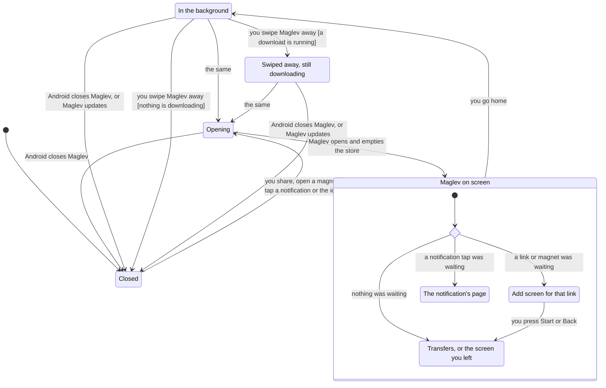

# Share hand-off

The code this model maps to lands with pull request #232 (`fix/1.0.1-share-handoff`). Until that merges, the files and functions named below are on that branch, not on `dev`.

How a link reaches the right screen. A link can come from a share, from a magnet or `.torrent` opened in another app, or from a tap on one of Maglev's own notifications or its Quick Settings tile. The model checks that it lands on the right screen even when Android closes Maglev, rebuilds its task from Recents, or installs an update in between.

The trouble starts with how Android treats a start intent. It keeps the intent that started a task and hands it to the app again every time it rebuilds that task. In Maglev 1.0 a shared link was the start intent. So a link you had already added came back later, when you opened Maglev from its icon after Android had closed it.

The fix keeps every link in a one-shot store (`ShareHandoff.kt`). Maglev reads the store once and then it is empty. The app itself always starts from the plain launcher intent.

Check it:

```bash
node scripts/check-models.js specs/share-handoff
```

## States

The chart shows the design that shipped (`AllStore.cfg`).



"The same" means every way into Maglev listed on the arrow from Closed. The chart leaves out an update while Maglev is already closed, which changes nothing on screen but makes the What's New card due.

## Rules

Each rule is an invariant in `ShareHandoff.tla`. TLC checks it in every state it can reach.

| Rule | In plain words |
|---|---|
| `NoStaleLink` | A link or magnet you already finished never opens its Add screen again. |
| `LatestShown` | When Maglev is on screen, it shows the newest thing you opened. |
| `NoCardOverShare` | The What's New card never opens on top of a link you shared. |
| `TypeOK` | Every variable holds the kind of value its comment promises. |

## Designs tried

Each design is a `.cfg` that sets `DESIGN`. The rejected ones stay, with the rule they break, so `check-models.js` keeps proving why they were rejected.

| Design | What it did | Result |
|---|---|---|
| `StartIntent.cfg` | Maglev 1.0. Each link is the start intent of the task. | `LatestShown` breaks in 6 steps: you share link a, Android closes Maglev before it opens, you share link b, Android closes it again, you tap the icon. Android rebuilds the task from its first intent and Maglev shows a, not b. With `LatestShown` taken out of the cfg, `NoStaleLink` breaks in 7 steps: you share a link and press Start, go home, Android closes Maglev, you tap the icon, and the same Add screen opens again. |
| `OnceAll.cfg` | Shares and magnets go through the store. A real start URL counts as newer and drops whatever waits in the store. | `LatestShown` breaks in 4 steps: you tap a notification, Android closes Maglev, you share a link. Android rebuilds the task from the notification's intent, that start URL drops the share, and Maglev shows the notification's page. |
| `StoreWins.cfg` | As above, but at a fresh start a waiting link wins over the start URL. | `LatestShown` breaks in 4 steps: you share a link, Android closes Maglev before it opens, you tap a notification. The old share wins and the notification's page never shows. |
| `AllStore.cfg` | Notification and tile taps go through the store too, so nothing but the launcher ever starts the task. | All rules hold in all 872 reachable states. |

The last two failures have the same cause. While the store and the start intent both carry links, one of them can be older than the other, and no rule for picking one is always right. Sending every link through the store leaves one source, and the newest entry replaces the older one.

## Actions and the code they stand for

| Action | Code |
|---|---|
| `YouShare` | `QuickShareActivity.kt` `launchApp`: puts the link in the store with `ShareHandoff.put` and starts the app from the launcher intent. |
| `YouOpenAMagnet` | `plugins/withShareIntents.js` sends magnet and `.torrent` VIEW intents to `QuickShareActivity`, so they take the same path as a share. |
| `YouTapANotification` | `Notifications.kt` `contentIntent`, `WatchNotifier.kt` `link`, `UpdateNotices.kt` `aboutIntent` and `MaglevTileService.kt` all build `ShareHandoff.routeIntent`. `QuickShareActivity` accepts only routes that pass `ShareHandoff.allowedRoute`. |
| `MaglevOpens`, fresh start | `app/+native-intent.tsx` `redirectSystemPath` with `initial`: calls `takeStartLink` (`utils/shareHandoff.ts`), which calls `ShareHandoff.take(startUp = true)`. A stored entry wins over the start URL. |
| `MaglevOpens`, back to the front | `components/ShareHandoff.tsx` calls `takeSharedLink` on mount and whenever the app becomes active. A link that arrives through `Linking` while the app runs is newer, so `dropPendingShare` empties the store. |
| `MaglevOpens`, the What's New card | `components/HighlightSheet.tsx` `usePlainLaunch`: a launch that took a link from the store (`sharedLaunchFlag`) is not a plain launch, so the card waits. |
| `YouFinish` | Start or Back on `app/add-download.tsx` and `app/add-torrent.tsx`. |
| `YouTapIcon`, `YouGoHome`, `AndroidKillsMaglev`, `YouSwipeAway`, `MaglevUpdates` | Android does these. No Maglev code runs; they are what the code has to survive. |

## What the model leaves out

- A stored entry older than ten minutes is dropped (`ShareHandoff.MAX_AGE_MS`). The model has no clock.
- Before onboarding is done, start-up leaves the store alone and the main screens take it later.
- Several `.torrent` files shared at once travel as one packed link. The model treats them as one link.
- The trusted-link mark for video sites travels with the stored entry and is not modelled.
- The constants are two links, one magnet and one notification route. That is enough for a newer link to meet an older one of each kind. TLC has not checked larger sets.

## On a phone

Each counterexample above is also a sequence to try on a phone with the shipped build. To play "Android closes Maglev", go home and run `adb shell am kill com.maglev` (it only closes an app that is in the background).

The `NoStaleLink` path from `StartIntent.cfg` is the bug users saw in 1.0, and it is easy to repeat:

1. Share a link to Maglev and choose Open in Maglev.
2. Press Start on the Add screen.
3. Go home, then run `adb shell am kill com.maglev`.
4. Tap the Maglev icon. Maglev must open on Transfers, not on the Add screen for the same link.

The shortest `OnceAll` path has Android close Maglev while it is still starting. A longer path breaks the same rule and works on a phone:

1. Tap a Maglev notification, so Maglev opens on its page.
2. Go home, then run `adb shell am kill com.maglev`.
3. Share a link to Maglev and choose Open in Maglev. The Add screen for that link must open, not the notification's page.

The `StoreWins` path needs Android to close Maglev in the moment between the card and the app's first screen. A phone can't do that on cue, which is why the model found it and testing did not.
