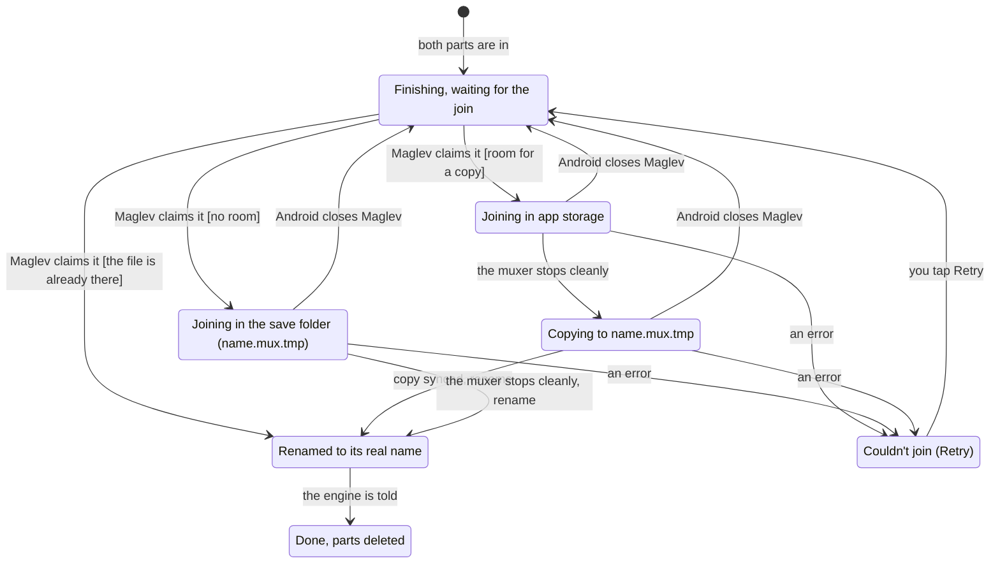

# Joining video and audio

Most video-site downloads come as two files, one with the video and one with the sound. When both are in, the card says "Finishing" while Maglev joins them into one mp4 (no re-encoding). Then the download is done and the two parts are deleted.

Writing the join straight into a shared folder such as `Download/Maglev` is slow: a 35 MB join took about 80 seconds. So Maglev now joins in its own storage and copies the finished file over. That adds a file and two steps, and Android can close Maglev between any two of them. The model checks that no order of events leaves a half-written file under the real name, deletes the parts too early, or calls a download done without its file.

Check it:

```bash
node scripts/check-models.js specs/stream-join
```

## Goal

The join takes seconds, not minutes, and closing Maglev at any moment never costs you the download.

## States

The chart shows the design that ships (`StreamJoin.cfg`). "Closed" can happen from every state; Maglev starts the join again when it opens.



## Rules

| Rule | In plain words |
|---|---|
| `NoHalfFileVisible` | Nothing under the real name is ever half written. A gallery, a file manager, or Maglev's own "already joined" check after a restart only ever sees a whole file. |
| `NoLostOutput` | The parts are deleted only once the joined file is in place under its real name. |
| `DoneMeansFile` | The engine never calls the download done without its file. |
| `NoLeftoverWhenDone` | A finished download leaves no temporary file behind, in app storage or in the save folder. |
| `TypeOK` | Every variable holds the kind of value its comment promises. |

## Designs tried

| Design | What it did | Result |
|---|---|---|
| `StreamJoin.cfg` | When the save folder is shared storage and there is room for one more copy, join in app storage, copy to `<name>.mux.tmp` in the save folder, sync, rename. Otherwise join into `<name>.mux.tmp` in the save folder and rename. | All rules hold in all 38 reachable states. |
| `DirectOnly.cfg` | Maglev 1.1: always join into `<name>.mux.tmp` in the save folder and rename. | All rules hold in all 16 reachable states. It was safe, only slow, which is why it stays as the fallback when there is no room. |
| `MuxIntoFinal.cfg` | Join straight into the file under its real name. | `NoHalfFileVisible` breaks in 2 steps: Maglev claims the join, the muxer starts writing. If Android closes Maglev now, the next start sees a file under the real name and reports it as joined. |
| `DeletePartsEarly.cfg` | Join in app storage, then delete the parts to free space before the copy. | `NoLostOutput` breaks in 3 steps: Maglev claims the join, the muxer starts, the muxer stops and the parts go. If Android closes Maglev during the copy, the leftover cleanup deletes the only copy. |

## Actions and the code they stand for

| Action | Code |
|---|---|
| `AppClaimsJoin` | `EngineHost.runPendingMuxes`: `muxTracker.claim` hands out the wait once; `StreamMuxer.sweepWork` clears leftover join files once per process, before any join starts. `MuxRunner.run` reports a non-empty file under the real name as joined. `StreamMuxer.mux(context, ...)` picks the route from `isAppStorage` and `roomForWork` (`StatFs`), and deletes this download's work file and `<name>.mux.tmp` before writing. |
| `MuxStarts`, `MuxEnds` | `StreamMuxer.writeJoin`, into the work file (`viaWork`) or into `<name>.mux.tmp` (`mux(video, audio, output)`). |
| `CopyStarts`, `CopyEnds` | `StreamMuxer.copyDurably`, then `work.delete()` in `viaWork`. |
| `RenameIntoPlace` | `tmp.renameTo(output)` in `viaWork` and in `mux(video, audio, output)`. Same folder, so one atomic rename. |
| `EngineHearsDone` | `nativeFinishMux` → `finish_mux` → `finish_files` in `native/maglev-core/src/http_dl/driver.rs`: checks the file is there, then `remove_stream_parts` deletes the parts and `<name>.mux.tmp`. |
| `JoinFails` | The `catch` blocks in `viaWork` and `mux` delete the work file and `<name>.mux.tmp`; `MuxRunner.run` reports `MUX_FAILED`. |
| `YouRetry` | Retry on the card: `retryDownload`, which puts the download back into `verifying`. |
| `AndroidKillsMaglev`, `MaglevStarts` | Android does these. No Maglev code runs; they are what the code has to survive. |

## What the model leaves out

- Several downloads joining at once. Each uses its own work file (named after the download id) and its own `<name>.mux.tmp`, so they never touch each other's files.
- Removing the download in the middle of a join. Rust deletes the parts and `<name>.mux.tmp`; the join then fails or the engine refuses the report, and `MuxRunner` deletes the file it made. Same as before this change.
- The engine refusing the report (`NOT_REPORTED`). `MuxRunner` deletes the file this run made, and the next poll joins again. The parts are still there, so no rule is at stake.
- A chosen folder without a direct path. Those downloads are saved in app storage and copied into the folder after they are done; the join itself takes the save-folder route there, because the parts are already in app storage.
- Power loss. The copy and the save-folder join are synced to disk once before the rename, so a rename never points at an empty file, but the model has no disk cache.
