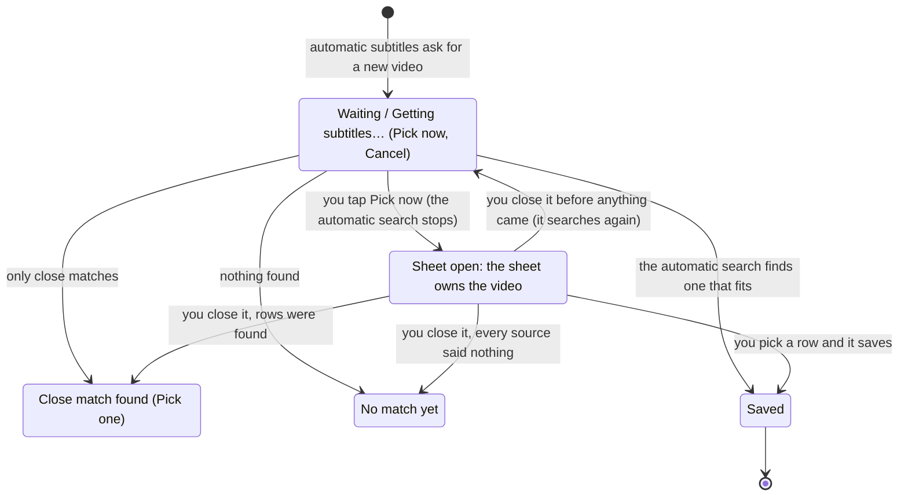
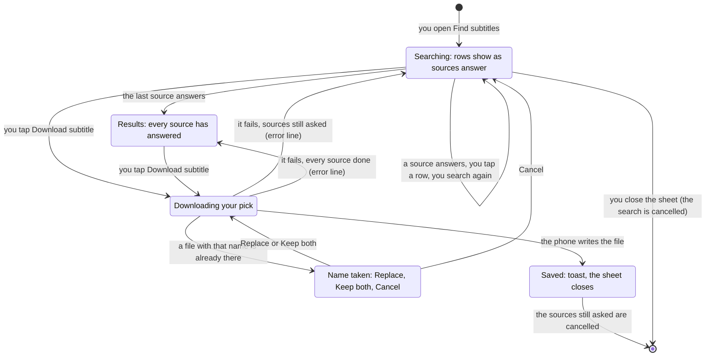

# Subtitle search: pick while sources are still searching

## Goal

With automatic subtitles on, a new video is searched on its own, and the Subtitles row on its page says "Getting subtitles…". That search decides only once every source has answered. While it runs, the row now offers **Pick now** (with Cancel beside it). Pick now opens the sheet and hands the video over to it: the automatic search stops, nothing automatic is saved while the sheet is open, and the sheet shows rows as they come. If you close the sheet without saving, the row shows what the sheet found ("Close match found", "No match yet"), never a "Getting subtitles…" with nothing running.

Find subtitles asks every subtitle source at once, and rows show as each source answers. You can pick any row that is on screen and download it while the other sources are still being asked. The line under the rows, "Asked 5 of 21 sources", says more may come. Rows that arrive while your pick downloads are kept, so if the pick fails you go back to a complete list.

For a season pack, Use best match shows as soon as one episode has a sure match. It never waits for the other episodes, and it never saves an episode you skipped or already picked by hand.

The models check that the row always offers the sheet while the automatic search runs, that the automatic search and the sheet never both write a subtitle for one video, that a row on screen can always be picked, that nothing a source found goes missing, that the row downloaded is the row you tapped, and that a pick never carries over into a new search or a reopened sheet.

Check it:

```bash
node scripts/check-models.js specs/subtitle-search
```

## What was wrong

The bug report: subtitles were already found, but none could be picked until every search was done.

**The automatic search (the reported bug).** In `components/subtitles/rowModel.ts`, a `queued` or `searching` run offered only Cancel, and in `SubtitlesRow.tsx` Cancel skips subtitles for the video. The runner (`run` in `components/subtitles/useSubtitleRequests.ts`) fingerprints the video and then awaits `searchSubtitles` with no progress callback. It decides only when the slowest source has answered or timed out, and a season pack's episodes go two at a time. So while it ran, there was no way to see or pick what had been found. `PickableWhileAuto` breaks in 1 step in `AutoToday.cfg`.

**The sheet.** The model and the code show three faults in the sheet. Its state machine already accepted a tap and a download while searching, so `PickableWhenShown` holds in `Today.cfg`. What failed was the rest of the pick:

- **Answers that landed during a pick were thrown away.** `sheetMachine.ts` ignored a search update unless the sheet was searching or showing results. The search sends each source's answer once. Any rows found while your pick downloaded, or while the name question was open, never reached the list. If the pick failed, or you chose Cancel at the name question, the list stayed incomplete. The sheet never learned the search had ended: "didn't respond" and "No subtitles found" never showed, and a tab with no rows kept its loading placeholders. `NothingFoundIsLost` breaks in 6 steps.
- **Nothing said more rows were coming.** The "Asked n of N sources" line went away as soon as the first row showed. Meanwhile the list kept reordering as sources answered, because a late match can rank above the rows already there.
- **A save left the search running.** When a save closed the sheet, the sources still being asked carried on to the end, using data and parsing pages on the same thread that handles your taps. `QuietAfterClose` breaks in 6 steps in `Today.cfg` (TLC reports `NothingFoundIsLost` first, at the same depth).

The native side doesn't serialise anything. `saveSubtitle`, `unzipSubtitles` and `subtitleHash` each run on Kotlin's `Dispatchers.IO` pool (`EngineHost.ioScope`), so a save never waits behind a search. Searches don't touch native code at all: they are `fetch` calls from JS.

Each source gets at most 8 seconds (`guarded` in `utils/subtitles/search.ts`), and all sources are asked in parallel. A single sheet search that takes 45 seconds to 2 minutes therefore points elsewhere. Either it is a season pack's episode runs, which go two at a time, or the JS thread is too busy for its own timers to fire on time. If the second, taps would wait too. A phone trace answers which; see "On a phone", step 6.

## States

The automatic search and the sheet for one video (`AutoHandOver.cfg`):



While the sheet is open, the runner starts no search and no save for the video. A write is the one part nobody can stop. If the automatic save's write is already under way when the sheet opens, the sheet's Download waits for it to end. If you close the sheet while its own write is under way, the runner waits for that.

The sheet on its own (`SubtitleSearch.cfg`):



Sources keep answering during Downloading and the name question. Their rows are in the list when the pick comes back to it. While a pick runs, the rows, the language tabs and the pencil are off.

Use best match (`BestMatch.cfg`): each episode's own search ends in saved (a result that fits), or in "waiting for you" with or without a sure best match. The button takes the sure ones of that moment. It checks each episode is still waiting before saving it.

## Rules

`AutoHandOver.tla`:

| Rule | In plain words |
|---|---|
| `PickableWhileAuto` | While the automatic search is queued or searching, the row offers the sheet. |
| `OneWriter` | The automatic search and the sheet never write a subtitle for the video at the same time. |
| `NoAutoSaveUnderSheet` | The automatic search never starts a save while the sheet is open for the video. |
| `NoStuckGetting` | After the sheet closes, the row says "Getting subtitles…" only while a search or its write is really going, and "Waiting" only when the runner is free to start one. |
| `TypeOK` | Every variable holds the kind of value its comment promises. |

`SubtitleSearch.tla`:

| Rule | In plain words |
|---|---|
| `PickableWhenShown` | Any row on screen can be tapped whenever no pick is running, whatever the other sources are doing. |
| `NothingFoundIsLost` | Once no pick is running, the sheet shows what every source has said: no rows that came in are missing, and a source that finished never still counts as being asked. |
| `ResultsNeverDisappear` | A row you tapped stays on screen and stays the one chosen, however the list reorders as sources answer. |
| `PickIsWhatYouTapped` | The row being downloaded is the row you tapped. |
| `NoStalePick` | A running pick always belongs to the search and the video on screen. A new search or a reopened sheet never inherits one. |
| `SavedToItsVideo` | Every subtitle is written next to the video its search was for. |
| `OnePickAtATime` | While a pick runs, no row can be tapped and no second download starts. One search saves at most one subtitle. |
| `SearchGoesOnDuringPick` | A pick never stops the search. The sources still being asked keep answering. |
| `QuietAfterClose` | A closed sheet asks no source. It costs no data, and no late answer can reach the next sheet. |
| `TypeOK` | Every variable holds the kind of value its comment promises. |

`BestMatch.tla`:

| Rule | In plain words |
|---|---|
| `OneFilePerEpisode` | An episode never gets two subtitle files on its own. A second one needs your Keep both. |
| `NothingSavedAfterSkip` | After you skip the pack, Use best match writes nothing more for it. |
| `OnlyFinishedEpisodes` | Use best match works only on episodes whose own search has ended. |
| `TypeOK` | As above. |

Two decisions are in the rules:

- **One pick at a time, by refusing the second.** While a pick downloads, the rows are off. Replacing a running pick would race its save: the first file may already be on its way to disk when you tap the second. A download takes a few seconds, so waiting costs little.
- **Searching goes on during a pick and stops at a save.** If the pick fails, the rest of the list is ready. A save closes the sheet with a toast, so nothing is left to choose. The remaining sources are cancelled, so they use no more data.

## Designs tried

| Design | What it did | Result |
|---|---|---|
| `AutoHandOver.cfg` | The row offers Pick now while automatic. Opening the sheet cancels the automatic search and holds the video. The sheet's Download waits for any write under way. Closing hands back what the sheet found. | All rules hold in all 95 reachable states. |
| `AutoToday.cfg` | The row before this fix: a queued or searching run offers only Cancel. | `PickableWhileAuto` breaks in 1 step: automatic subtitles ask for a new video, and the row offers nothing but Cancel. |
| `AutoNoAbort.cfg` | The sheet holds the video, so no new automatic run starts, but it leaves the running automatic search alone. | `NoAutoSaveUnderSheet` breaks in 4 steps: the video is asked for, the search starts, you tap Pick now, and the search finds a match that fits and starts saving under the open sheet. On the same path `OneWriter` breaks after 8 steps: you also pick a row, it downloads, and the two writes overlap. |
| `AutoNoWait.cfg` | The sheet cancels the automatic search but doesn't wait for a write already under way. | `OneWriter` breaks in 7 steps: the automatic search finds a fit and its write starts, you tap Pick now, rows show, you tap Download subtitle, the download ends, and the sheet's write starts beside the automatic one. |
| `SubtitleSearch.cfg` | Answers are kept during a pick. Rows are picked by their source and id. A pick is refused a new search, and a close detaches it. A save or a close cancels the search. | All rules hold in all 1,545 reachable states. |
| `Today.cfg` | The sheet before this fix. Answers that land during a pick are dropped, and a save closes the sheet without cancelling the search. | `NothingFoundIsLost` breaks in 6 steps: you open the sheet, one source answers, you tap its row and Download, the other source answers, and the download fails. The second source's rows never show, and the sheet still says it is asking. `QuietAfterClose` also breaks in 6 steps: the same, but the save works, and the sheet closes with a source still being asked. |
| `WaitsForAll.cfg` | The behaviour the bug report describes: rows show, but a tap counts only once every source is done. | `PickableWhenShown` breaks in 2 steps: you open the sheet and one source answers with a row while another is still asked. |
| `ByIndex.cfg` | The sheet remembers the position you tapped, not the row. | `ResultsNeverDisappear` breaks in 4 steps: you open the sheet, one source answers, you tap its row, and a second source's row ranks above it. The chosen position now holds the other row. |
| `PickSurvives.cfg` | A running pick carries on through a new search, or through closing and reopening the sheet. | `NoStalePick` breaks in 5 steps: you open the sheet, a source answers, you tap its row and Download, then search again with a typed name. The download still running belongs to the old search. |
| `BestMatch.cfg` | The bulk checks each episode is still waiting before saving it, and skipping the pack cancels its downloads. | All rules hold in all 126 reachable states. |
| `BestMatchNoRecheck.cfg` | The bulk saves every episode it took at the tap without looking again, and a skip leaves its downloads running. | `NothingSavedAfterSkip` breaks in 5 steps: an episode's search ends with a sure match, you tap Use best match, you skip the pack, and the bulk still downloads and writes the file. |

## Actions and the code they stand for

`AutoHandOver.tla`. The hand-over registry is in `utils/subtitles/requests.ts`: `holdVideo`, `isHeld`, `beginWrite`, `isWriting`, `writesDone` and `handBack`.

| Action | Code |
|---|---|
| `AutoAsks` | `useSubtitleRequests` asks for every new transfer when automatic subtitles are on (`askSubtitles` with `byRunner`). |
| `RunnerStarts` | The runner's loop starts `run` for a run `planRun` allows. It now also skips a video that `isHeld` (its sheet is open) or `isWriting` (a write is under way). `run` registers its controller with the video's path (`registerRun`). |
| `RunnerDecides` | `run`: `searchSubtitles`, then `outcomeFromRanked`. Before an automatic save it checks `isHeld` and `isWriting` again. If either is set, the run goes back to queued instead of saving. Otherwise it saves inside `beginWrite`. |
| `RunnerWriteEnds` | `downloadAndSave` resolves, `endWrite` runs, and `setRun` writes `saved`. |
| `YouOpenSheet` | The row's Pick now (`rowModel`, `waiting`, action `pick`, Cancel as `extra`) opens `SubtitleSheet`. So do the card icon and a searching episode row (`episodeStart`). The sheet's `targetKey` effect calls `holdVideo`, which aborts the automatic run for that video; its `finally` puts the run back to queued. |
| `SheetFindsRows`, `SheetSearchEnds` | The sheet's own search, `SourceAnswers` in `SubtitleSearch.tla`. |
| `YouTapDownload`, `OtherWriteEnded` | The sheet's download effect awaits `writesDone`, then wraps `downloadAndSave` in `beginWrite`. |
| `SheetDownloadEnds`, `SheetWriteEnds` | As `DownloadEnds` and `SaveEnds` below. A save calls `markSaved`. |
| `YouCloseSheet` | The cleanup of the `holdVideo` effect: `handBackOf` (in `sheetMachine.ts`) turns the sheet's last state into needs-pick, none or queued. `handBack` writes it, but only over a queued or searching run, and the card state follows (`recordState`). Then the hold is released, which wakes the runner. |
| `LateWriteEnds` | The download effect's aborted branch records the save. `endWrite` runs when `downloadAndSave` settles, so the runner waits for it. |
| `Done` | No code. |

Use best match also leaves a held or writing episode alone: `valid` in `bulkSave.ts` checks `isHeld` and `isWriting`, and its save runs inside `beginWrite`.

`SubtitleSearch.tla`. The sheet is `components/subtitles/SubtitleSheet.tsx`, and its rules are in `components/subtitles/sheetMachine.ts` (`sheetReducer`).

| Action | Code |
|---|---|
| `YouOpen` | `SubtitleSheet` effect on `targetKey`: dispatches `OPEN` (`startSearch`) and bumps `runKey`, which cancels any earlier search. |
| `SourceAnswers` | `searchSubtitles` in `utils/subtitles/search.ts` asks every provider in parallel through `guarded` (8 s each) and calls `onUpdate` after each one. The sheet's search effect dispatches `SEARCH_UPDATE`. The reducer keeps the rows and source states during `downloading` and `name-taken`, without moving the phase or the selection. A late row can rank above others (`rankCandidates`). |
| `YouTapRow` | A row's `PressableScale` sends `SELECT` with `rowKey` (`providerId:id`), accepted while the list shows (`showsList`). Rows are disabled while `downloading`. |
| `YouTapDownload` | Download subtitle sends `DOWNLOAD` (`canDownload`) and bumps `dlKey`. The download effect reads the target and the selected row once, at its start. |
| `DownloadEnds` | `downloadAndSave` in `components/subtitles/flow.ts` calls `downloadAndPrepare` (15 s). A failure dispatches `DOWNLOAD_FAILED`, which returns to `searching` or `results` (`listPhase`) with the error line. |
| `SaveEnds` | `downloadAndSave` calls `saveWithChoice`, then `maglevEngine.saveSubtitle` (Kotlin `MaglevEngineModule` `saveSubtitle`, on `EngineHost.ioScope`). The result is `SAVED`, `NAME_TAKEN`/`COPIES_FULL` or `DOWNLOAD_FAILED`. On `saved`, the phase effect shows the toast, bumps `runKey` (cancels the search) and closes. |
| `YouAnswerNameQuestion` | `CHOOSE` with `replace`, `keep-both` or `cancel`. Cancel returns to `listPhase`. |
| `YouSearchAgain` | `SEARCH_NAME`, `USE_FILE_NAME` and `RETRY_SEARCH` (also sent on coming back from Settings with other sources on). `send` bumps `runKey`. All three are accepted only while the list shows, and the pencil is off while downloading. |
| `YouClose` | `close()`: forgets the card's "getting" state, dispatches `CLOSE`, bumps `runKey` (cancels the search) and `dlKey` (stops waiting for the download). |
| `LateSaveEnds` | The download effect's aborted branch: a save the phone finished after the sheet closed records the saved state and the toast for its own target. |
| `Done` | No code. Every search the model allows is used. |

`BestMatch.tla`:

| Action | Code |
|---|---|
| `SearchEnds` | `run` in `components/subtitles/useSubtitleRequests.ts`: `searchSubtitles` for one episode, then `outcomeFromRanked`. A fits result is saved at once. Otherwise the run is `needs-pick` and keeps `toStored` candidates. |
| `YouTapUseBestMatch` | Use best match on the Subtitles row or the status sheet: `useSeasonBulk().start` in `components/subtitles/bulkSave.ts`. It takes `qualifyingRuns` (`utils/subtitles/season.ts`) at the tap. |
| `BulkStarts` | `runBulk`'s `one` in `utils/subtitles/season.ts` calls `deps.valid`. `valid` in `bulkSave.ts` checks the epoch, not skipped, and the run still `needs-pick`. |
| `BulkSaveEnds` | `deps.save` in `bulkSave.ts` calls `downloadAndSave` with the normal choice. A taken name is `stay`. A save is marked (`markSaved`) only if the run is still valid. |
| `BulkEnds` | `runBulk` returns, and `bulkOnce` clears `active` and writes the result line. |
| `YouPickByHand` | An episode row opens `SubtitleSheet` for that file (`onOpenEpisode` on the torrent page). Its save calls `markSaved`. |
| `YouSkip` | `skipSubtitles` in `utils/subtitles/requests.ts` marks the pack skipped and calls `abortKey`. That cancels the bulk's downloads, which register through `registerRun`. |
| `Done` | No code. |

## Out of scope

- **The default selection.** A row in "Fits this file" is chosen for you until you tap one. It may move as better rows arrive, and once you tap, it stays. The model has only your taps.
- **Language tabs.** The model is one tab. A tab change clears the selection, so it is off while a pick runs, like the rows.
- **Time.** The 8-second limit per source and the 15-second limit per download are why every source ends. The model lets a source answer or fail at any moment, which covers both.
- **A save the phone is already writing when you reopen the sheet and pick again.** The native write takes milliseconds. If it lands first, the second save gets the name question, which is the designed way to get a second file.
- **What the automatic search found so far.** The runner still decides only when every source has answered, and the row doesn't count results while it runs. Pick now runs the sheet's own search, which streams. Making the runner stream (for "n found so far") is a separate change.
- **Cancel.** Cancel (skip) works as before; the model doesn't need it, because a skipped run is never touched by the runner or by `handBack`.
- **A queued episode of a season pack.** It may have no file yet, so its row in See all still doesn't open the sheet. A searching episode does.
- **Two open sheets for one video.** Only one sheet shows at a time. The hold counts, so it would stay correct anyway.
- **How fast the phone is.** If the JS thread is too busy, taps and timers both wait. The model can't see that, and a phone trace can.

## On a phone

The automatic search first (the reported bug). Turn on Settings → Subtitles → Get subtitles for new videos, with many sources on.

A. **Pick now** (`AutoToday`, 1 step). Add a video torrent. Once it has bytes on disk, open its page: the Subtitles row says "Getting subtitles…" with **Pick now** and Cancel under it, both at least 44 dp. Tap Pick now. The sheet opens and rows show as sources answer. Pick an early row and download it: the sheet closes with the toast, and the row says "<language> · fits this release".
B. **No automatic save under the sheet** (`AutoNoAbort`, 4 steps). As A, but leave the sheet open without picking until "Asked N of N". No toast and no subtitle file appear on their own while the sheet is open (check the folder, or watch for the toast).
C. **Close without a save.** As A, then close the sheet once rows have shown. The row says "Close match found" with Pick one, not "Getting subtitles…". Do it again on another video and close the sheet before any row shows: the row says "Waiting for the file" or "Getting subtitles…", and the automatic search really runs again (a toast or "Close match found" follows on its own).
D. **One writer** (`AutoNoWait`, 7 steps). Hard to hit on cue. Pick a video whose automatic search usually finds a fit, tap Pick now the moment the row changes, and pick a row at once. Expect at most the "A subtitle with this name already exists" question, never two files for one pick.
E. **Season pack.** In See all, tap an episode that says it is searching. Its sheet opens and its automatic search stops. Close the sheet: the list comes back, and that episode shows what the sheet found.

Then the sheet on its own. The paths TLC found, turned into steps. Use a show or movie where some sources answer quickly and others are slow (many sources on in Settings → Subtitles → Sources).

1. **Pick while searching** (`WaitsForAll`, 2 steps). Open Find subtitles. As soon as the first rows show, and "Asked n of N sources" is still under them, tap a row. It is selected at once, and Download subtitle turns on. Tap it: the subtitle saves and the sheet closes with a toast.
2. **Nothing found is lost** (`Today`, 6 steps). Open Find subtitles. Tap an early row and Download subtitle. While it downloads, let more sources answer: the line under the rows keeps counting. Make the download fail by turning on airplane mode right after tapping Download, then turn it off. The list comes back with the error line. It has the rows that arrived during the download, and once every source is done the "Asked" line goes away (and "n sources didn't respond" shows, if any didn't).
3. **The name question mid-search.** Save an English subtitle for a video. Open Find subtitles again and, while sources are still asked, pick another English row. At "A subtitle with this name already exists", tap Cancel. The list is back, complete, and still counting.
4. **What you tap is what you get** (`ByIndex`, 4 steps). Tap a row low in the list while sources are still answering. Watch it as later rows arrive above it: the highlight moves with your row and stays on it, and Download subtitle downloads that release (check the toast's language and the file name in the folder).
5. **A new search or a close during a download** (`PickSurvives`, 5 steps). Tap a row and Download subtitle. While it downloads, the pencil and the language tabs are greyed out. Close the sheet with Back while it downloads. If the download hadn't finished, nothing is saved and the card's subtitle icon clears. If the phone was already writing it, the toast still shows and the file is next to the video you started with. Reopen the sheet: it starts a fresh search, with no row selected.
6. **The search stops when you save** (`QuietAfterClose`). Pick an early row and save it while sources are still asked. The sheet closes. With `adb logcat` (or a network log), no more subtitle-site requests follow the toast. While searching, note how long the sheet takes to reach "Asked N of N". More than about 10 seconds for one video means the JS thread is the bottleneck: record a Hermes profile in the React Native dev menu and attach it to the issue.
7. **Use best match** (`BestMatchNoRecheck`, 5 steps). Add a season pack with automatic subtitles. Open See all while episodes are still searching. Use best match shows as soon as one episode has a sure match, and tapping it saves those episodes while the others keep searching. Then the skip path: add a pack from Search, tap Use best match, and while it says "Saving 1 of k" tap Skip subtitles in the Search tab's message. Nothing more is saved for the pack.
