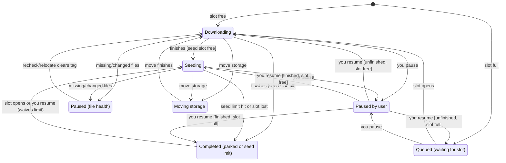

# Torrents

Torrents move between downloading, queued, seeding, completed, paused, moving, and file-health states. Rust's pure planner (`scheduler.rs`) assigns download slots and seed slots in `added_at` order, enforces seed ratio/time limits unless the user waived them by resuming, keeps health-tagged torrents stopped without overwriting a user pause, and leaves moving torrents alone.

The model checks two torrents competing for 1 download slot and 1 seed slot across completion, seed limits, user pauses/resumes, health tags, and storage moves.

Check it:

```bash
node scripts/check-models.js specs/torrents
```

## States

The chart shows one torrent's lifecycle in the shipped design (`Torrents.cfg`).



## Rules

Each rule is an invariant in `Torrents.tla`. TLC checks it in every state it can reach.

| Rule | In plain words |
|---|---|
| `DownloadSlotsRespected` | Active downloading torrents never exceed `max_active_downloads`. |
| `SeedSlotsRespected` | Active seeding torrents never exceed `max_active_seeds`. |
| `FinishedNeverQueued` | A finished torrent without a seed slot is parked as **Completed**, never shown as **Queued**. |
| `HealthNeverRuns` | A torrent with a file-health tag never runs until the tag is cleared. |
| `UserPauseWins` | A torrent you paused never runs and is never queued, even when slots open or health tags appear. |
| `WaivedNeverSeedLimited` | Once you resume a torrent past its seed limit, the planner never pauses it for seed limits again. |
| `TypeOK` | Every variable holds the kind of value its comment promises. |

## Designs tried

Each design is a `.cfg` that sets `DESIGN`. The rejected ones stay, with the rule they break, so `check-models.js` keeps proving why they were rejected.

| Design | What it did | Result |
|---|---|---|
| `Torrents.cfg` | Shipped design (`scheduler.rs` + `engine.rs`): separate download/seed slots, `Action::Park` for finished torrents without a seed slot, health checked before candidates, and `limits_waived` on resume. | All rules hold in all 784 reachable states. |
| `QueueFinished.cfg` | Sent finished torrents without a seed slot to `Action::Queue` instead of `Action::Park`. | `FinishedNeverQueued` breaks in 2 steps: `"a"` finishes and takes the seed slot, `"b"` finishes and lands in `QUEUED` instead of `COMPLETED`. |
| `HealthIgnored.cfg` | Planner skipped the health check before assigning slots. | `HealthNeverRuns` breaks in 1 step: missing files trigger on the running torrent and it keeps running. |
| `NoLimitsWaived.cfg` | Planner ignored `limits_waived` after the user resumed a seed-limited torrent. | `WaivedNeverSeedLimited` breaks in 4 steps: `"a"` finishes, hits its seed limit, you resume it, and the planner pauses it for `seed_limit` again. |

## Actions and the code they stand for

| Action | Code |
|---|---|
| `DownloadFinishes` | `engine.rs` tick (`real_finished` flips true) → `scheduler.rs` `plan`. |
| `SeedLimitHits` | `scheduler.rs` `seed_limit_hit` → `Action::Pause { reason: "seed_limit" }`. |
| `YouPause` | `engine.rs` `pause` (`reject_if_moving`, sets `paused_by = "user"`). |
| `YouResume` | `engine.rs` `resume_with` (`reject_if_moving`, rejects health tags, sets `limits_waived = true` when resuming from `seed_limit`). |
| `HealthTriggers`, `HealthClears` | `engine.rs` health check / `set_health` / recheck (`scheduler.rs` health-first branch). |
| `MoveStarts`, `MoveFinishes` | `engine.rs` `move_storage` (`TorrentState::Moving`, hidden from planner). |

## What the model leaves out

- **Governance rules (`wifi_only`, `vpn_required`, `battery`, `schedule`, `seed_metered`, `storage_full`) and "Resume anyway":** modelled separately in [`specs/transfer-rules/`](../transfer-rules/).
- **Magnet resolution (`INITIALIZING`, `no_peers`) and `CHECKING`:** before metadata arrives or while hashing, a torrent has no download/seed slot conflict of its own; once verified it enters the states modelled here.
- **More than 2 torrents or larger slot limits:** 2 torrents with 1 download slot and 1 seed slot are enough for two torrents to compete for both slots, park, and swap when one pauses, finishes, hits a seed limit, or moves.
