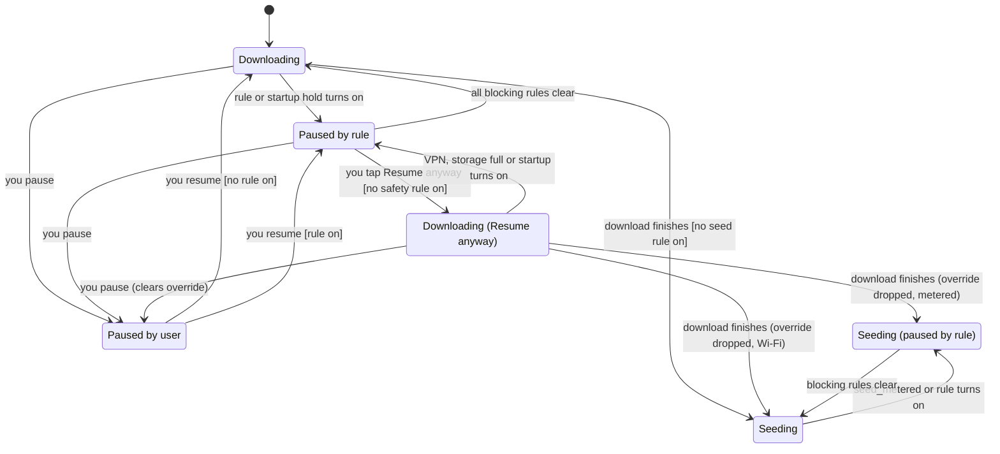

# Rules that hold transfers

Maglev pauses transfers automatically when a user rule or safety condition blocks them: **Wi-Fi only** (`wifi_only`), **VPN only** (`vpn_required`), **Battery cut-off** (`battery`), **Charging only** (`charging_only`), **Schedule** (`schedule`), **Storage full** (`storage_full`), **Seeding on mobile data** (`seed_metered`), and the **startup** hold (`startup`) while the engine boots.

Kotlin evaluates device state and pushes active tags into Rust (`Engine.blocked`). Rust's planner (`scheduler.rs`) decides whether each transfer runs or pauses, while the user can pause, resume, or tap **Resume anyway** on a single item. The model checks that user pauses always win, safety rules (`vpn_required`, `storage_full`, `startup`) can never be bypassed, a download's **Resume anyway** never leaks into seeding on mobile data, and no rule tag ever gets stuck once all applicable blocks clear.

Check it:

```bash
node scripts/check-models.js specs/transfer-rules
```

## States

The chart shows the shipped design (`TransferRules.cfg`).



## Rules

Each rule is an invariant in `TransferRules.tla`. TLC checks it in every state it can reach.

| Rule | In plain words |
|---|---|
| `UserPauseStaysPaused` | A transfer you paused never runs and never keeps an old **Resume anyway** override until you resume it. |
| `SafetyRulesAlwaysHold` | Safety and physical rules (`vpn_required`, `storage_full` while downloading, and `startup`) always stop the transfer, even if you tapped **Resume anyway**. |
| `NoSeedLeak` | A **Resume anyway** tapped while downloading is cleared on completion and never lets the finished torrent seed on mobile data. |
| `NoStuckRuleTag` | When you didn't pause the transfer and no active rule applies to it, it is running and carries no stale `paused_by` tag. |
| `TypeOK` | Every variable holds the kind of value its comment promises. |

## Designs tried

Each design is a `.cfg` that sets `DESIGN`. The rejected ones stay, with the rule they break, so `check-models.js` keeps proving why they were rejected.

| Design | What it did | Result |
|---|---|---|
| `TransferRules.cfg` | Shipped design (`scheduler.rs` + `engine.rs` + `EngineHost.kt`): `EXEMPTABLE_TAGS` limits overrides, `allowed_anyway` clears on user pause and on download completion, and user pauses are never overwritten by rule tags. | All rules hold in all 768 reachable states. |
| `OverrideBypassesAll.cfg` | Treated `allowed_anyway` as bypassing every governance tag, including `vpn_required` and `storage_full`. | `SafetyRulesAlwaysHold` breaks in 2 steps: `vpn_required` turns on, you tap Resume anyway, and the transfer runs with no VPN. |
| `OverrideLeaksToSeeding.cfg` | Forgot to clear `allowed_anyway` when an overridden download finished. | `NoSeedLeak` breaks in 3 steps: `wifi_only` turns on, you tap Resume anyway to finish the download, it finishes, and it keeps seeding on mobile data. |
| `UserPauseOverwritten.cfg` | Let a rule turning on overwrite `paused_by = "user"` with the rule tag. | `UserPauseStaysPaused` breaks in 3 steps: you pause the transfer, `wifi_only` turns on and overwrites `paused_by`, `wifi_only` turns off, and the planner resumes the transfer you paused. |

## Actions and the code they stand for

| Action | Code |
|---|---|
| `RuleTurnsOn`, `RuleTurnsOff` | `EngineHost.kt` `evaluateGovernance` → `NativeCore.nativeSetTransfersAllowed` → `engine.rs` `set_transfers_allowed` + `scheduler.rs` `plan`. |
| `YouPause` | `engine.rs` `pause` (sets `paused_by = "user"`, clears `allowed_anyway` and `allowed_anyway_seeding`). |
| `YouResume` | `engine.rs` `resume` → `resume_with(id, false)`. |
| `YouResumeAnyway` | `EngineHost.kt` `resumeAnyway` → `engine.rs` `resume_anyway` → `resume_with(id, true)`. |
| `DownloadFinishes` | `engine.rs` poll tick (`if m.allowed_anyway && stats.finished && !m.allowed_anyway_seeding { m.allowed_anyway = false }`). |
| `EngineRestarts` | `EngineHost.kt` `startEngine` → `nativeInit` (inserts `"startup"` hold until `evaluateGovernance(force = true)` lifts it). |

## What the model leaves out

- **`charging_only`, `offline`, `network_unvalidated`:** `charging_only` behaves identically to `battery` (exemptable); `network_unvalidated` behaves identically to `vpn_required` (non-exemptable); `offline` is non-exemptable for link downloads and is filtered out for torrents (`engine.rs` `torrent_blocked`). Keeping one representative of each class plus the phase-specific tags (`seed_metered`, `storage_full`, `startup`) exercises every branch of `tag_blocks` without multiplying the state space.
- **Per-torrent queue slots and seed limits:** covered separately by the Torrents model (`scheduler.rs` queue/park logic).
- **Network-off session rebuild debounce (`NETWORK_OFF_DEBOUNCE_MS`):** affects DHT/listener teardown when VPN drops; transfers themselves pause immediately via `vpn_required`.
