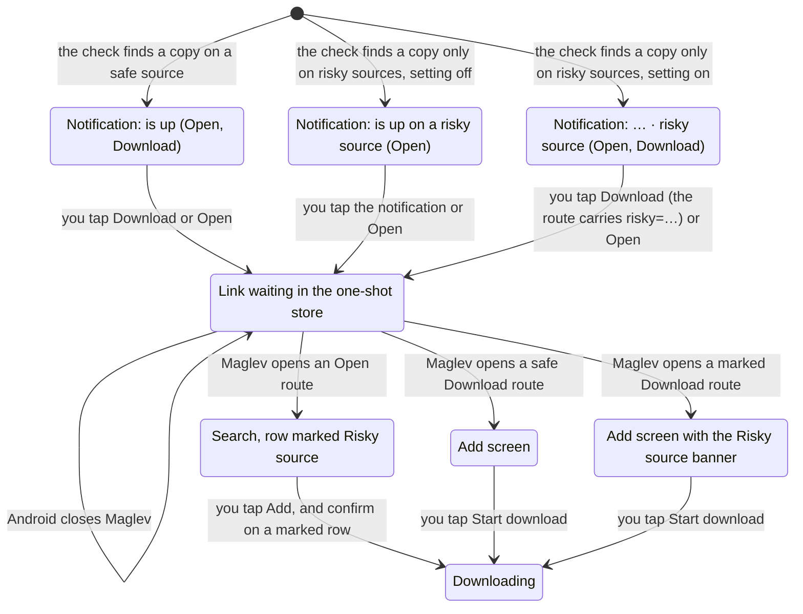

# Watches and risky sources

A watch re-runs a search in the background and posts "<title> is up" when a new copy shows up, with Open and Download buttons. Some search sources are known for fake or malware uploads (The Pirate Bay, 1337x, TheRARBG). Search marks a result "Risky source" when every source behind it is one of them, and asks before adding it. Up to 1.1.1, a watch searched those sources too, but its notification and the Add screen it opened never said so: a fake upload was one tap away, without the warning Search shows (issue #224).

Now a copy that only risky sources list is still announced, but without Download: the notification says "is up on a risky source" and opens Search, where the row carries its warning. Settings, Watches, "Download from risky sources" (off by default) brings Download back for such copies; the notification then says "risky source", and the Add screen shows the same warning banner. The model checks that no such copy reaches a download without that warning on screen, including when Android closes Maglev between the tap and the screen.

Check it:

```bash
node scripts/check-models.js specs/watch-risky-sources
```

## States

The chart shows the design that shipped (`WatchRiskySources.cfg`), for one new copy.



A copy the search hides ("Trusted uploaders only" drops an ordinary member's Pirate Bay upload) is never announced, as in Search.

## Rules

Each rule is an invariant in `WatchRiskySources.tla`. TLC checks it in every state it can reach.

| Rule | In plain words |
|---|---|
| `NoSilentRiskyDownload` | A copy Search would mark as risky never starts downloading unless its warning was on screen when you started it. |
| `SameRulesAsSearch` | A watch announces only what Search would list for the same settings, and calls it risky exactly when Search does. |
| `WarningTravels` | An Add screen opened for a copy Search would mark as risky shows the banner, even after Android closed Maglev between the notification and the screen. |
| `TypeOK` | Every variable holds the kind of value its comment promises. |

## Designs tried

| Design | What it did | Result |
|---|---|---|
| `Today.cfg` | Maglev 1.1.1. Every new copy gets Download, and nothing says the source is risky. The file checks only `NoSilentRiskyDownload`, the rule the bug is about; `SameRulesAsSearch` and `WarningTravels` break on the same path, sooner. | `NoSilentRiskyDownload` breaks in 5 steps: a Pirate Bay upload appears, the watch posts "is up" with Download, you tap Download, Maglev opens the Add screen with no warning, you tap Start download. |
| `MemoryOnly.cfg` | The watch notes "risky" in memory for the Add screen, instead of putting it in the Download route. | `WarningTravels` breaks in 5 steps: a Pirate Bay upload appears, the watch posts it with Download (setting on), you tap Download, Android closes Maglev before it opens, Maglev opens the Add screen without the banner. |
| `IgnoresTrusted.cfg` | The watch marks risky copies like Search, but searches every uploader, ignoring "Trusted uploaders only". | `SameRulesAsSearch` breaks in 2 steps: an ordinary member uploads to The Pirate Bay, and the watch announces a copy Search hides. |
| `WatchRiskySources.cfg` | Copies only on risky sources get Download only with the setting on; the mark rides in the route through the one-shot store; the watch searches with Search's prefs. | All rules hold in all 860 reachable states. |

## Actions and the code they stand for

| Action | Code |
|---|---|
| `CopyAppears` | Someone uploads it. No Maglev code runs. |
| `WatchChecks` | `utils/watch/task.ts`: `searchOnce` calls `searchAll` with the whole search prefs, so `trustedUploadersOnly` filters as in Search; `watchSafety` builds `riskyOf` from `riskySources` (`utils/search/safety.ts`) with `providerMap(prefs)` and `prefs.warnUnsafe`, the same inputs Search uses, and reads `prefs.watchRiskySources`. `utils/watch/cycle.ts` `runWatchCycle` passes `isRisky` to `evaluateWatch` (a safe fresh copy wins over a risky one) and builds the notification with `notificationFor` (`utils/watch/logic.ts`): `held` drops Download and says "on a risky source", `marked` adds "risky source" and `risky=<ids>` to `downloadUrl`. `WatchNotifier.notify` (Kotlin) adds Download only when `downloadUrl` is set. |
| `YouTapOpen`, `YouTapDownload` | `WatchNotifier.link` → `ShareHandoff.routeIntent` → `QuickShareActivity` → `ShareHandoff.put`, which writes the whole route, `risky=` included, to SharedPreferences. The route allowlist accepts `add-torrent?<anything without spaces>`. |
| `YouDismiss` | Android removes the notification. No Maglev code runs. |
| `MaglevShowsLink` | `app/+native-intent.tsx` `redirectSystemPath` at start-up (`takeStartLink`), or `components/ShareHandoff.tsx` while running (`takeSharedLink`). `stripShareMarker` keeps every parameter but `from`, so `risky` reaches `app/add-torrent.tsx`, which turns it into the banner with `riskyNotice` and shows it in the preview, while getting info (Start now) and after a timeout (Add anyway). |
| `YouOpenMaglev`, `YouGoHome`, `AndroidKillsMaglev` | You and Android. `AndroidKillsMaglev` is what the route-in-the-store design has to survive. |
| `YouStartOnAdd` | `app/add-torrent.tsx` `doAdd` / `startNow`. |
| `YouAddFromSearch` | `app/(tabs)/search.tsx` `requestAdd`: a row `riskySources` marks asks "Add from a risky source?" first. |
| `YouFlipSetting` | `app/settings/watch.tsx`, "Download from risky sources", saved in the search prefs (`utils/prefs/search.ts`, `watchRiskySources`), so a backup carries it with the other search settings. |

## What the model leaves out

- More than one copy and more than one watch. Each copy is judged on its own, and a notification replaces the previous one for the same watch.
- Settings other than "Download from risky sources" changing while a notification is up. "Warn about risky sources" and "Trusted uploaders only" are fixed per run, and TLC tries every combination. A notification already posted keeps its buttons when you flip the watch setting; its Download route still carries the mark, so the banner still shows.
- With "Warn about risky sources" off, Search marks nothing, so a watch marks nothing either and the watch setting is greyed out. That is the user's own choice in Search, and the rules follow Search.
- The store's 10-minute limit. A route that expires is simply not opened, which can't start a download.
- A `maglev://add-torrent` link from another app. It goes through the same screen; a `risky=` value there can only add a banner, and only for a source Maglev flags.

## On a phone

1. Settings, Search sources: turn off every source but The Pirate Bay. Search for a title that has new uploads (for example a daily show). Tap Watch.
2. Wait for the first check (or set Check every to 1 h and wait), then for a new upload. The notification reads "<title> is up on a risky source" and has Open only. Tap it: Search opens on the title, and the row says "Risky source: The Pirate Bay". Add asks "Add from a risky source?".
3. Settings, Watches: turn on "Download from risky sources". On the next new copy the notification reads "… · risky source" and has Download. Tap Download: the Add screen shows the "Risky source: The Pirate Bay" banner above the file list.
4. Repeat step 3, but after tapping Download press Home at once and run `adb shell am kill com.maglev`, then open Maglev. The Add screen still shows the banner.
5. With "Trusted uploaders only" on, a new upload by an ordinary member is not announced; turn it off and the same upload is announced, as Search shows it.
6. Settings, Search sources: turn off "Warn about risky sources". In Settings, Watches the switch is greyed out, and notifications for The Pirate Bay copies have Download with no mark, as Search adds them without asking.
